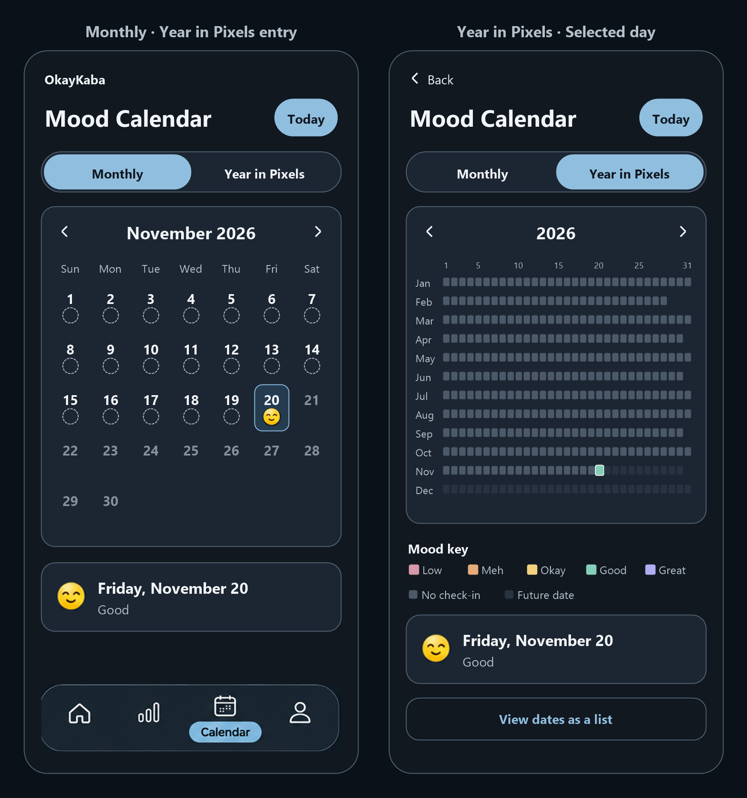
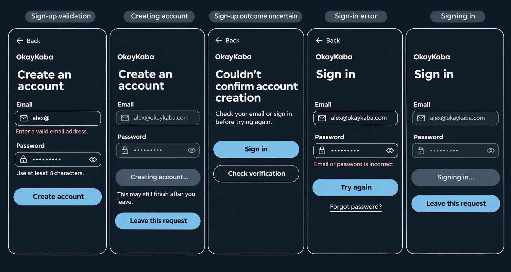
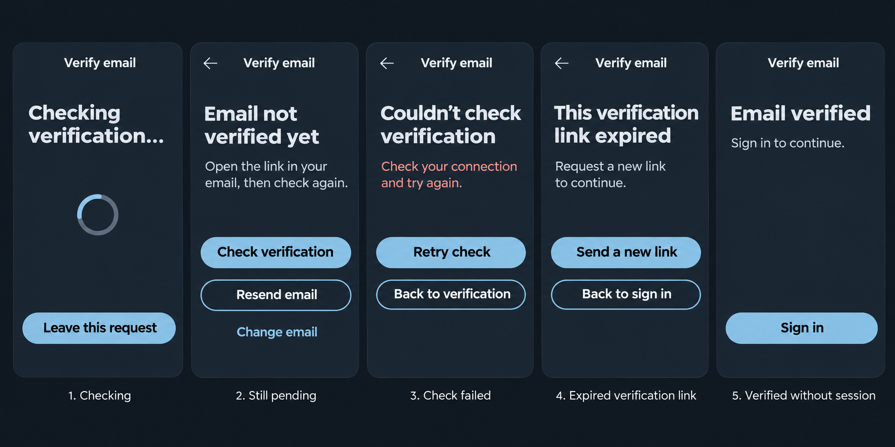
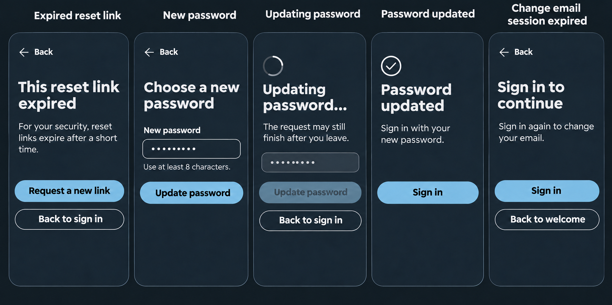
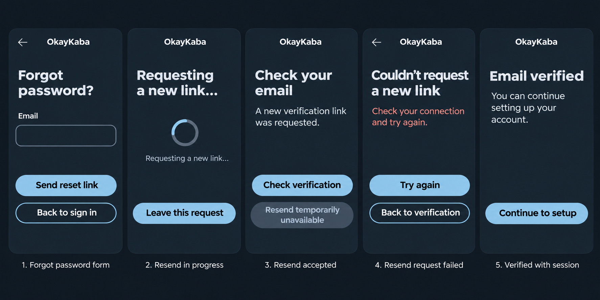
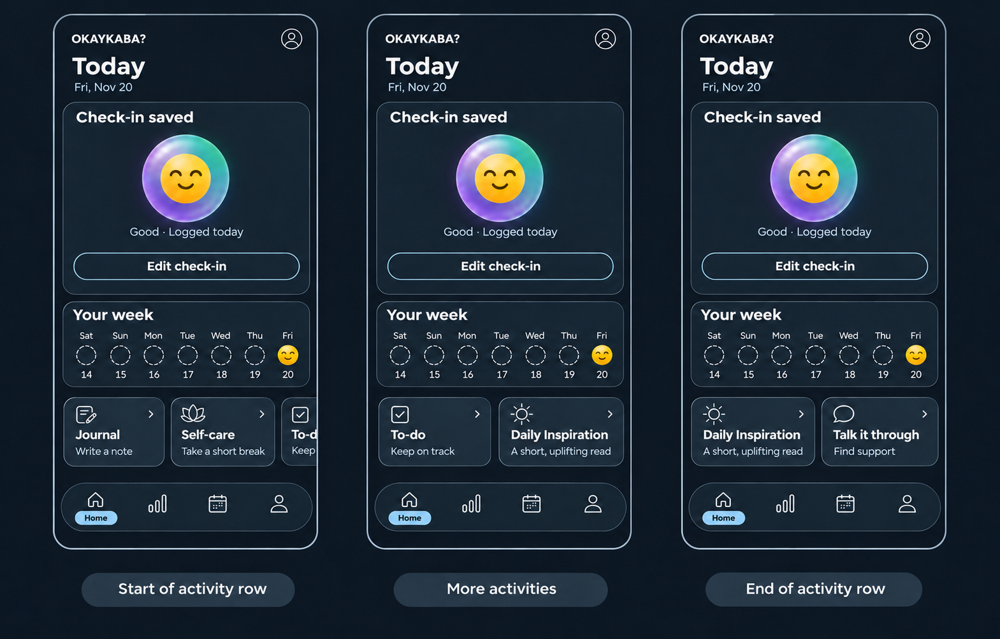

# OkayKaba · Final design handoff

[Open the full screen gallery](gallery.html)

This is the consolidated dark mockup set for OkayKaba. Start here for the final review pass and follow the linked boards for the rest of the app. The earlier boards still show the approved screen designs and interaction states. The Calendar, authentication and activity boards here settle the specific details called out in the last review.

| Area | Review board |
| --- | --- |
| First-run and Welcome | [Approved walkthrough](../revised-first-run-flow/v7-first-run-bridges/review.md), [dark entry and email forms](../full-app-design/01-opening-and-email.png), and the dark recovery boards below |
| Today and mood check-in | [Five check-in states](../today-check-in/review.md) and the activity entry board below |
| Journal | [Writing, draft, save and error states](../journal/review.md) |
| Calendar and Insights | [Approved empty and selected day states](../mood-calendar/review.md), the updated Calendar board below, and [Insights in the left panel](../full-app-design/02-insights-and-year.png) |
| Activities | [Daily tasks and Self-care](../full-app-design/03-tasks-and-self-care.png) · [Inspiration and Support](../full-app-design/04-inspiration-and-support.png) |
| Account | [Settings](../full-app-design/05-account-and-preferences.png) · [Signed-in Account and demo import](../full-app-design/06-account-data.png) |

## Calendar

The Monthly / Year in Pixels control appears above the month grid. **Year in Pixels** opens the year view using the same record and selection. Back or Monthly returns to the prior month and selection. **Today** in either view opens the current month and selects today's date. **Go to Today** in the empty month is the separate action that opens Home.

The annual grid has 12 month rows and 31 day columns, with cells only for dates that exist. The example has 365 real dates, one saved record on Friday, November 20, 2026, and 41 future dates. Mood colors apply to this overview. The caption for the selected date includes the date, the word Good and the same face as the monthly view. Future dates and past dates without a check-in look different. The whole app uses confirmed saved moods for Today, Insights and both Calendar views. A pending first save or failed first save leaves the date empty, and a failed edit keeps the previous confirmed record.

**View dates as a list** describes the accessible alternative to the dense overview. It uses a heading per month and full-width dated rows with the mood or “No check-in.” Choosing a row updates the selected day and its detail. Back returns to the year view at the prior position. The list layout is specified here. The board draws the monthly and year views.

## Dark account recovery

- Welcome uses the approved Google, email and demo ordering. Leave this request abandons navigation for the current request, and a delayed completion cannot override demo or a later sign-in attempt. When the keyboard is open, the first Android Back closes it.
- Sign-up with an uncertain outcome gives Sign in the primary action and Check verification as the secondary action. Verification that succeeds with no active session returns to Sign in. Verification with a valid session continues to setup or the appropriate route for an existing account.
- Resend results describe the accepted request. Availability of another resend follows the service state. Keep password and account copy aligned with the eventual service rules. Link expiry offers a fresh request and an exit.
- During a password update, the Back to sign in action abandons the pending screen and its navigation intent. The request may still finish. A confirmed outcome shows Password updated. An uncertain outcome should offer sign-in or a fresh reset link. For an email address change, Back is guarded only during the brief commit and restored at the uncertain result with Check status and Back to verification.
- The [dark password-reset recovery board](../revised-first-run-flow/v7-first-run-bridges/03-dark-password-recovery.png), [dark Change email board](../revised-first-run-flow/v7-first-run-bridges/02-dark-change-email.png), and [Google cancellation states](../revised-first-run-flow/v6-account-recovery/review.md) complete the flow. Treat email addresses shown on raster boards as sample data.

## Today activities and Back destinations

Place these activities immediately after Your week. The order is Journal → Self-care → To-do → Daily Inspiration → Talk it through. The row supports touch swiping and accessible traversal. A partial next card signals that there are more activities. Keep the row position as people return. The four-item dock is for top-level tabs. Activity subpages use Back.

| Today card | Opens | Back from the destination |
| --- | --- | --- |
| Journal | Journal with New entry or Resume draft | Opens Today at its prior scroll position. Back inside the editor first returns to Journal, preserving the draft as specified. |
| Self-care | Self-care activity list | Returns to Today. Back or End in the breathing exercise stops the exercise and returns to Self-care. |
| To-do | Daily tasks | Returns to Today. Back from Edit task returns to the task list. |
| Daily Inspiration | Today's quote with a Saved view and optional Bible verses | Returns to Today. Write in journal opens Journal as a child route, so Back returns to Inspiration. |
| Talk it through | Support entry with chat unavailable, Open journal and Support resources | Returns to Today. Back from Support resources or Journal returns to Talk it through. |

If Insights opens Journal or Daily tasks, Back returns to Insights. Entering Journal from a secondary route preserves the same draft. Vertical and horizontal position restoration is part of the navigation spec.

## Design boundary

These boards define interfaces and transitions. Some rare or combined states are covered by interaction notes, including enlarged-text combinations, uncertain storage outcomes and account return races. The Calendar board uses a system font approximation for the design drawing. Use the existing Plus Jakarta Sans design target for app typography. This handoff covers the design stage and keeps the app source separate.
