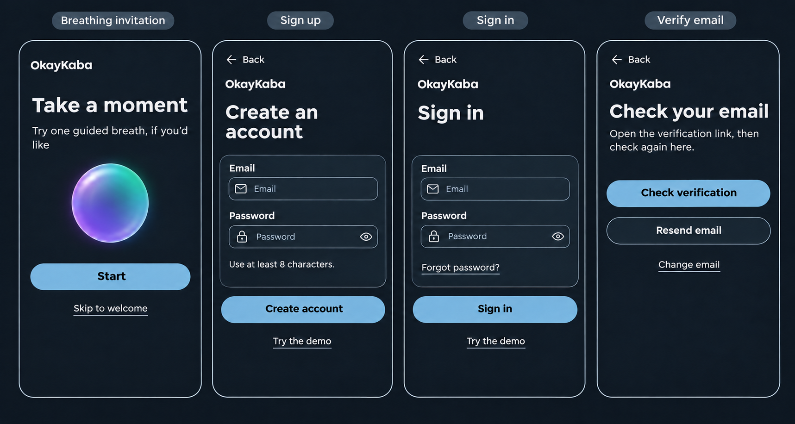
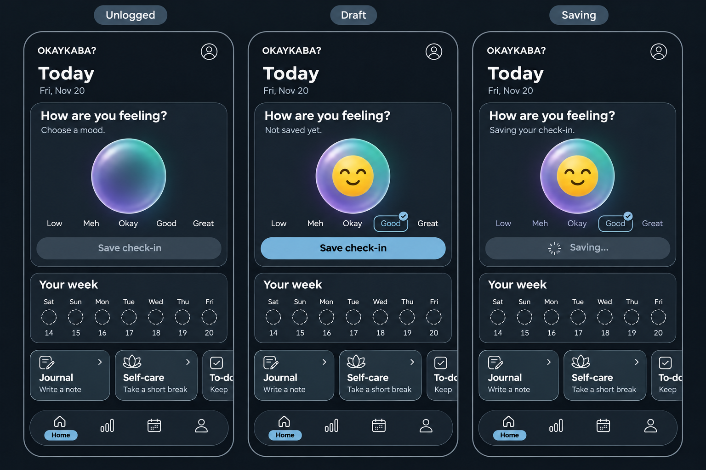
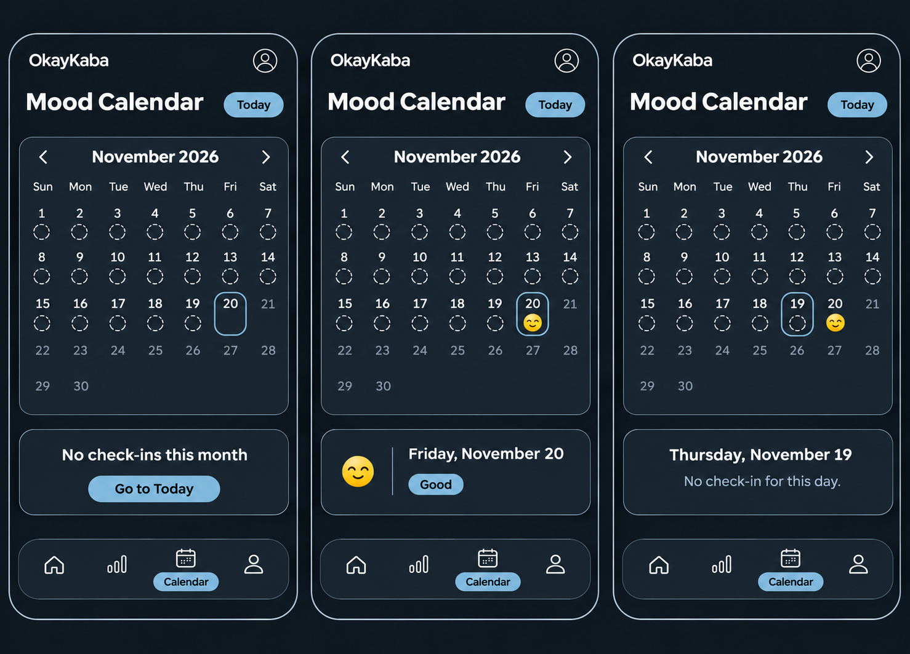
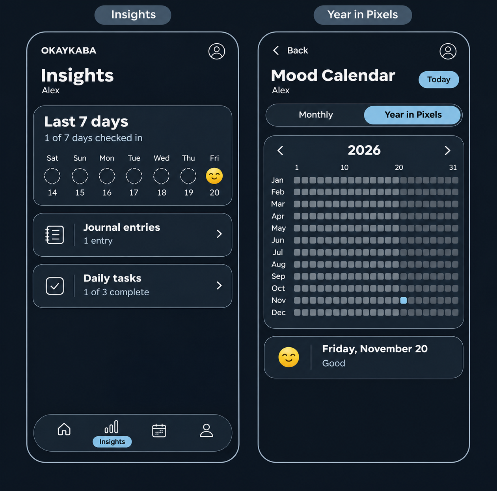
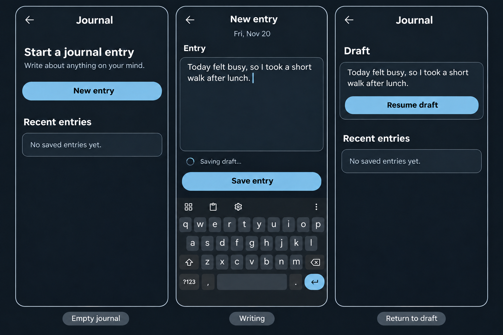
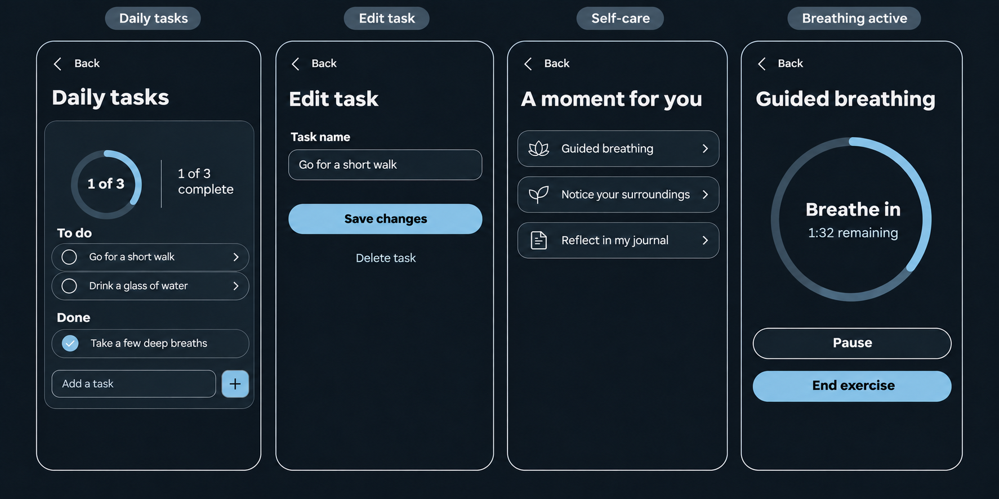
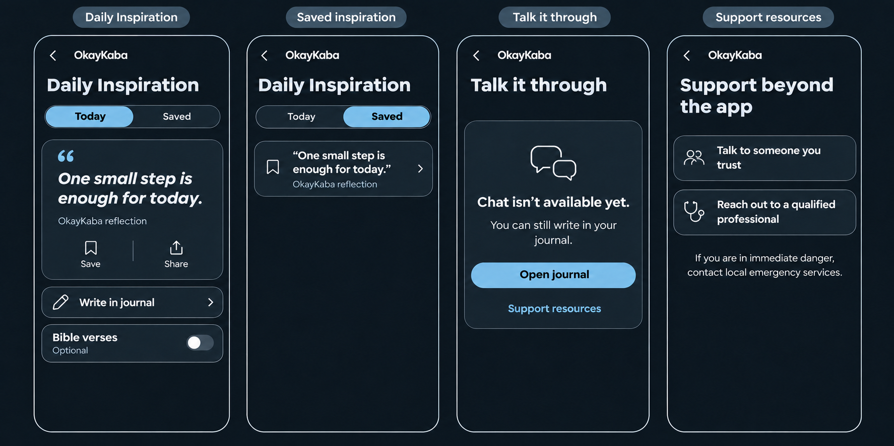
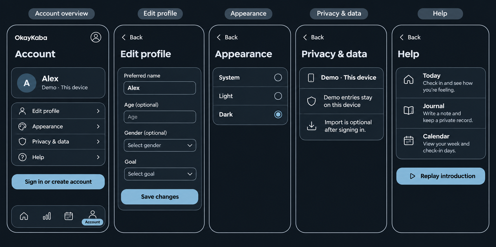
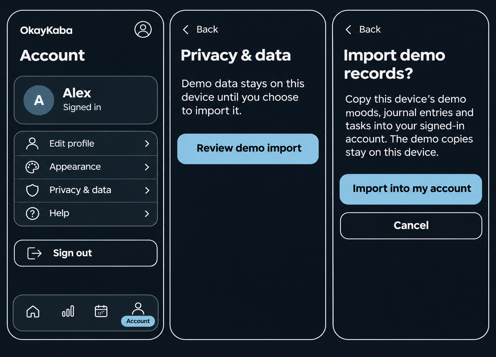

# OkayKaba · Full screen design set

One dark visual direction for the wellbeing app, from first-run to daily use and account settings. The approved Today, Journal, Calendar and first-run decisions are the foundation. The new boards extend that design. These are static screen boards for review.

| Area | Screen designs |
|---|---|
| First-run | Splash, optional breathing, Welcome with account choices, email sign-up and sign-in, verification, change email, password recovery, demo, name, mood practice, goal and completion |
| Home and history | Today, all five check-in states, Insights, Calendar month, selected day and Year in Pixels |
| Activities | Journal and draft/save states, Daily tasks and task editor, Self-care and active breathing, Daily Inspiration and saved quotes |
| Account and support | Account, Edit profile, Appearance, Privacy & data, demo import confirmation, Help, Talk it through and Support resources |

## 1. First-run and account entry

The approved account-choice screen doubles as Welcome. Breathing completion and Skip open it. Demo Back returns to the entry screen. Email update guards Back only while the update is being confirmed. Recovery offers Check status when the outcome is uncertain.

[Complete first-run walkthrough](../revised-first-run-flow/v7-first-run-bridges/review.md) · [Splash and breathing phases](../revised-first-run-flow/v2/01-opening-breath.png) · [Pause and reduced motion, first two panels](../revised-first-run-flow/v2/02-paused-welcome-demo.png) · [Account choice and Google states](../revised-first-run-flow/v6-account-recovery/review.md)

[Demo entry and ready](../revised-first-run-flow/v7-first-run-bridges/01-dark-demo.png) · [Change email](../revised-first-run-flow/v7-first-run-bridges/02-dark-change-email.png) · [Password recovery](../revised-first-run-flow/v7-first-run-bridges/03-dark-password-recovery.png) · [Setup steps](../revised-first-run-flow/v5-dark-account/01-default-setup.png) · [Setup and sync outcomes](../revised-first-run-flow/v7-first-run-bridges/04-dark-account-completion.png)

## 2. Today, Insights and Calendar

The bottom dock has four peer tabs: Home, Insights, Calendar, Account. Only the active tab shows its label. On Today, the Journal, Self-care, To-do and other activities scroll horizontally beneath Your week. The latest saved mood appears on Today, Insights and Calendar using the same record. In this sample, only Friday, November 20 has a saved mood. Insights reports what the person recorded and avoids drawing clinical conclusions.

[Today saved and error](../today-check-in/02-saved-and-error.png) · [Today behavior notes](../today-check-in/review.md)

The approved monthly view is the Calendar default. Add a Year in Pixels entry action to the monthly Calendar header. Back or Monthly returns from the annual overview to the monthly grid. The Today button in either Calendar view opens the current month with the current date selected. Go to Today in an empty state opens Home. The annual board illustrates the density and appearance of the grid. Its raster cell count and position are approximate. A real grid needs a cell for every valid date, a five-mood key and an accessible date list with the written mood.

## 3. Journal and daily tools

[Journal saving, confirmation and failure](../journal/02-save-and-recover.png) · [Journal behavior notes](../journal/review.md)

Task progress follows the completed and total items. Empty lists show 0 of 0 with a neutral ring. A checked row moves to Done, and unchecking returns it to To do. Delete offers Undo. Quick-add stays above the keyboard and out of the dock. Breathing offers Pause and End, with a static reduced-motion treatment. Secondary exercises and longer task states follow the same controls.

Daily quotes are the default. Bible verses are opt-in and can be switched off. Talk it through shows the unavailable chat state, with Journal and Support links. A connected AI experience needs its own review and verified service.

## 4. Account and settings

Use the mode label to distinguish device-only demo data from account data. Import requires a signed-in account and an explicit confirmation showing the data types. Cancel returns to Privacy & data, and the demo copy is preserved. Show account and import outcomes according to confirmed storage and sync status. Optional profile fields remain editable from Account.

## Review scope

These are screen-level mockups and existing interaction notes. Some secondary authentication states are illustrated in earlier light references within the first-run walkthrough. Additional combinations such as enlarged text, all storage failures, and a live AI chat are outside the current visual boards. The shortlist for design feedback is hierarchy, consistency across tabs, and whether all needed destinations are easy to find.
