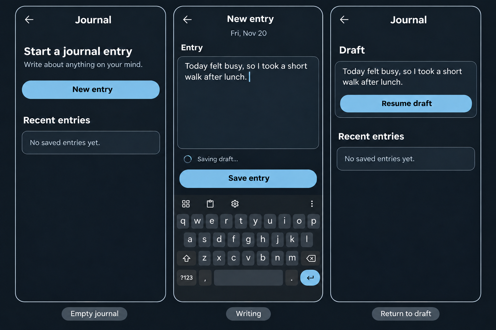
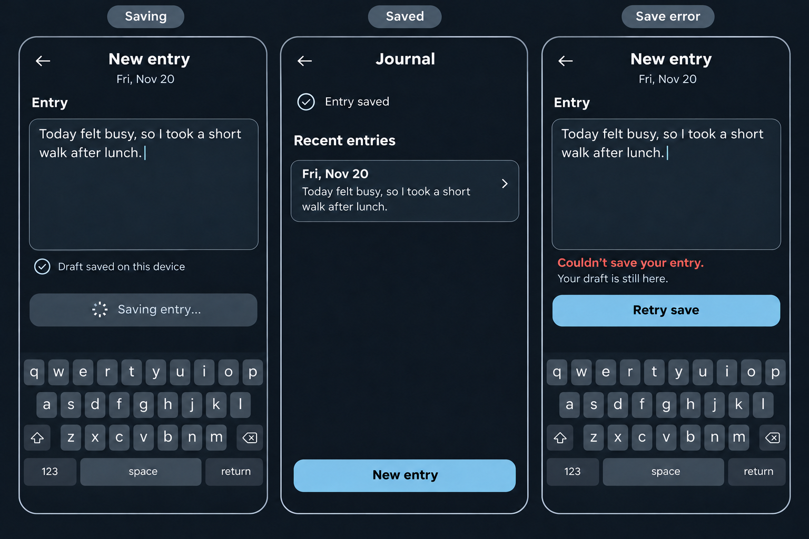

# OkayKaba · Journal mockups

The Journal activity on Today opens a dedicated Journal screen. The dark palette and restrained denim actions carry over from Today. The editor takes priority while writing, with Back to Journal and no tab dock competing with the keyboard.

| State | What changes | Next action |
| --- | --- | --- |
| Empty journal | New entry is primary. Recent entries explains that nothing has been saved yet. | Open a blank editor. |
| Writing | A persistent Entry label stays visible. The draft status sits next to Save entry, above the keyboard. | Keep writing, save, or go Back to Journal. |
| Return to draft | A Draft preview sits above and apart from Recent entries. | Resume the same text. |
| Saving entry | Keep the text visible with Saving entry… and prevent a repeat submission. | Wait for confirmation or recover from failure. |
| Saved | Return to Journal with Entry saved and one new row in Recent entries. The matching draft clears. | Tap the row to reopen it or start another entry. |
| Save error | Keep text editable. Show Couldn't save your entry and Retry save. | Retry or continue writing. |

## Draft and navigation behavior

- Use one active new-entry draft per mode and account or device profile. Back from the editor returns to Journal with the current draft. Back from Journal returns to the Today activity. On Android, the first Back while typing dismisses the keyboard.
- Show “Draft saved on this device” only after the local draft write succeeds. If the local write fails, keep the text in the editor and offer Retry draft save. If the user tries to leave while the latest text exists only in memory, offer Keep writing or Leave without saving and make the consequence clear.
- When final save starts, preserve the draft and identify the exact revision being saved. Verify an uncertain result before retrying, so a retry cannot create a duplicate entry. A stale completion must not clear newer typing or change screens after the person has left. If an account sync operation is separate, report it separately from the local save.
- Keep demo drafts and entries on the device and isolated from account data. Signing in does not transfer them. Scope draft previews and recent entries to the active mode.
- Keep the editor and action above the keyboard. Allow the layout to scroll and errors to wrap at larger system text sizes. Announce save and error feedback once, keep the caret when an error occurs and restore focus predictably after Back or Resume.

## Review boundary

This pass covers a new entry, draft recovery and the final save. Reopening a saved entry is noted as a destination. Editing and deletion are outside these boards. Keyboard clearance, draft restoration across a restart, interrupted saves, actual text scaling and screen-reader feedback need prototype testing.
