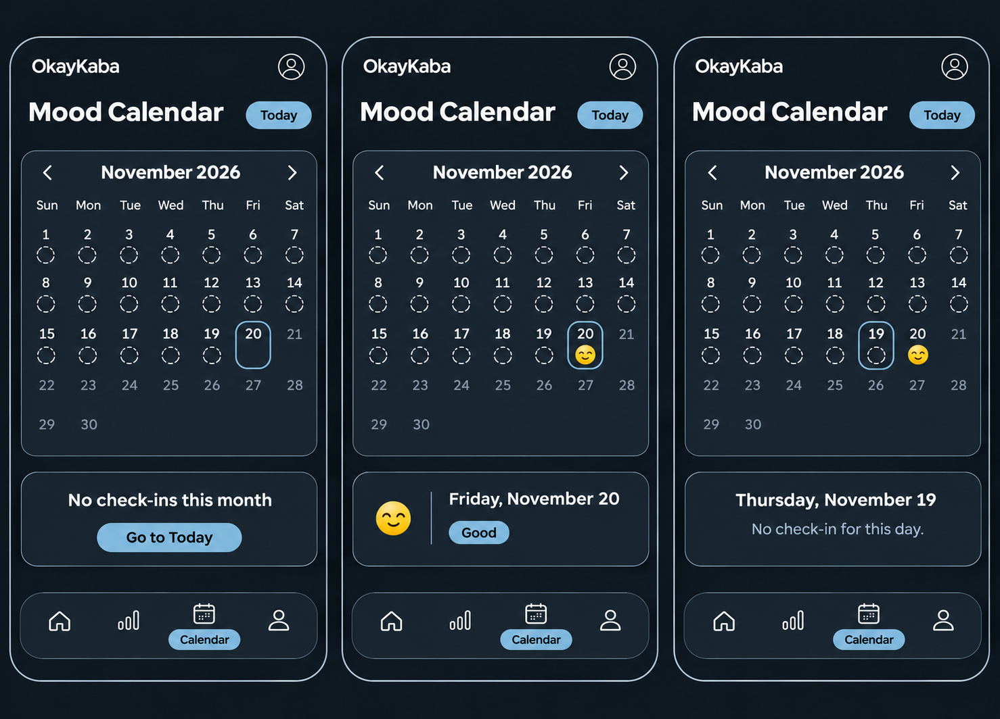

# OkayKaba · Mood Calendar mockups

The Calendar tab opens a monthly view with a day detail directly below the grid. It uses the same dark palette, denim highlights and yellow mood faces as Today. The board follows the same first check-in example, on Friday, November 20, 2026.

| State | Calendar | Detail and action |
| --- | --- | --- |
| Empty month | The month remains visible. Current and past dates without a record are empty rings. | “No check-ins this month.” Go to Today opens the inline check-in. |
| Saved day | A face sits beneath November 20. The outline shows the selected date. | “Friday, November 20” and the matching face with the written mood “Good.” |
| Day without a check-in | Selecting November 19 moves the outline. The saved marker stays on November 20. | “Thursday, November 19” and “No check-in for this day.” |

## Navigation and data rules

- Calendar is the third of four tabs. The Calendar label appears on the active tab. Previous and next arrows browse months. **Today** jumps back to the current month and selects today. This keeps the person in Calendar. **Go to Today** switches to Home and brings the check-in into view.
- On first entry select today. When changing months, clear selection and show “Select a day to see its details” if there are records, or the month-empty message if there are none. Individual past dates can still be tapped in an empty month. Keep selection separate from the marker for today. Future dates are muted and unavailable.
- In the empty-month frame, the blue outline around November 20 is a selection indicator. Use the same empty ring inside a selected unlogged cell in the eventual prototype, as shown on November 19.
- Read the same confirmed daily mood record as Today and Your week. A draft, an onboarding practice choice, and a failed first save leave the date empty. A failed edit keeps the previous saved mood. Match records by the local date stored at save time, including after a device timezone change.
- Keep demo and account history separate. Calendar detail shows the date and mood; journal text stays in Journal.
- Give each selectable date a spoken label with full date and mood or “No check-in,” plus its selected state. Use written mood labels in the detail and distinguish selection by shape as well as color. Support large type by allowing detail text to wrap and providing a date list if the grid cannot maintain usable targets. Test interaction with TalkBack and verify tap targets, contrast and text scaling in a prototype.

## Review scope

This board covers the monthly grid and day details. The existing [Year in Pixels concept](../okaykaba-flow-audit/08-calendar-insights.png) is a separate design reference. The mockups illustrate design intent. Month navigation, persistence and accessibility have yet to be tested in a prototype.
