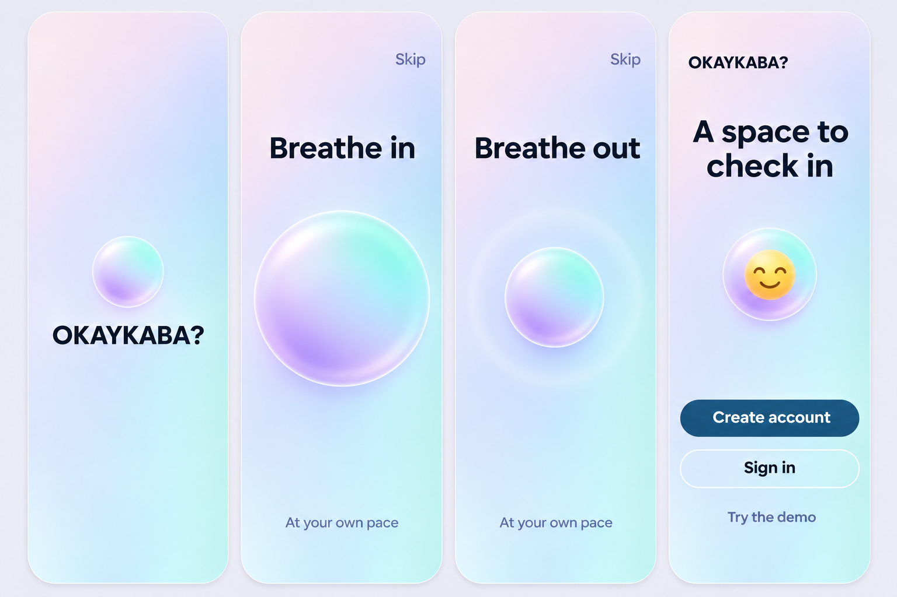
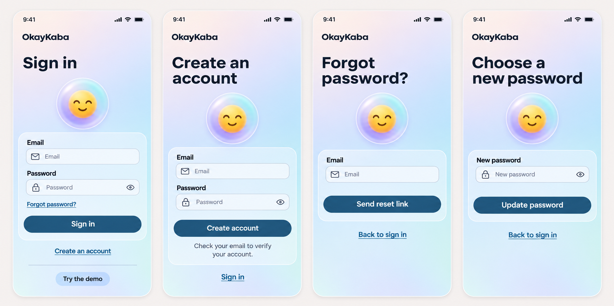
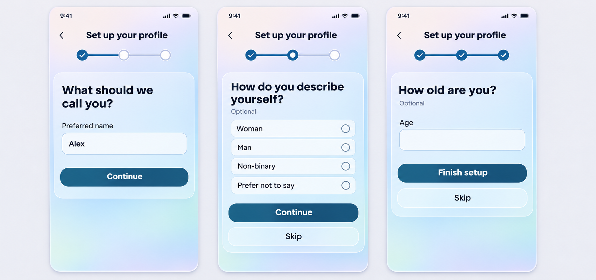
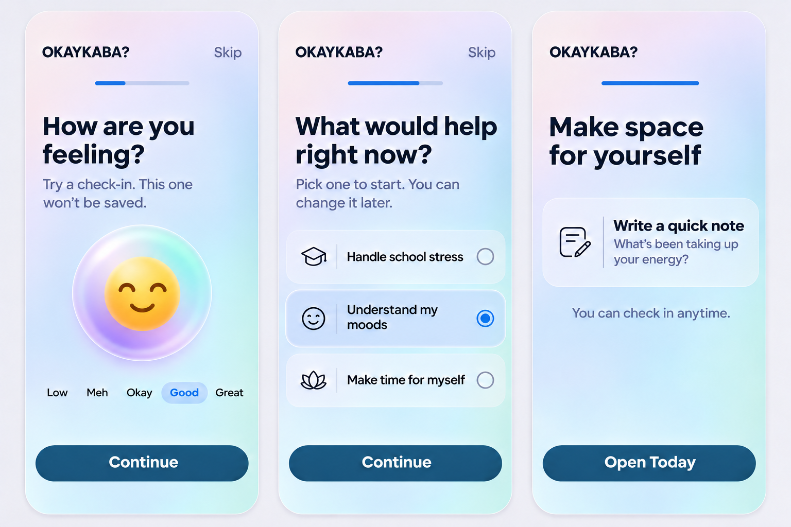
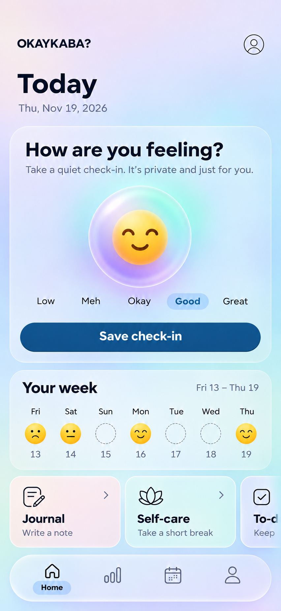
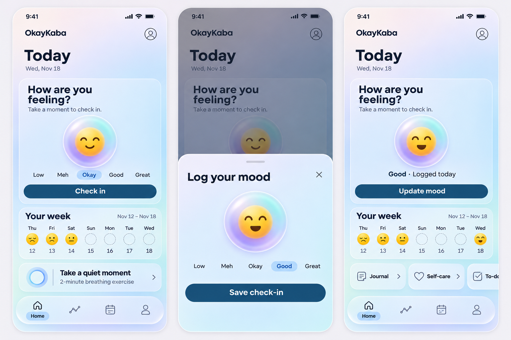
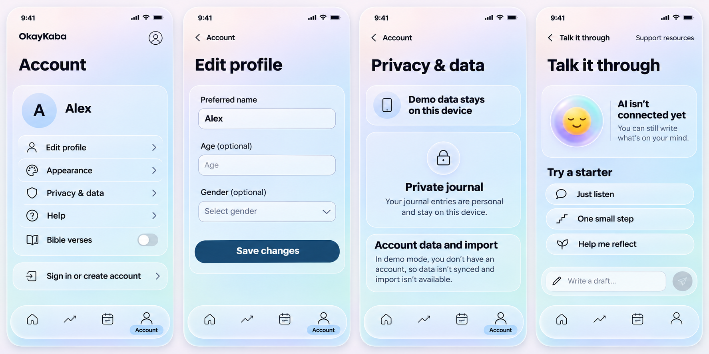
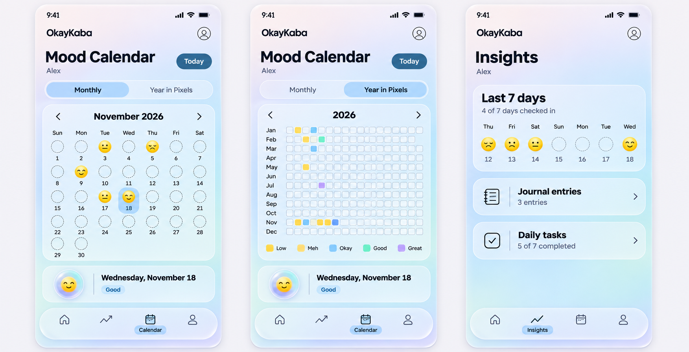
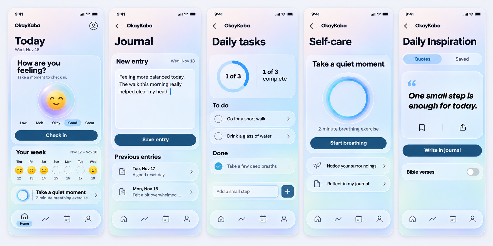
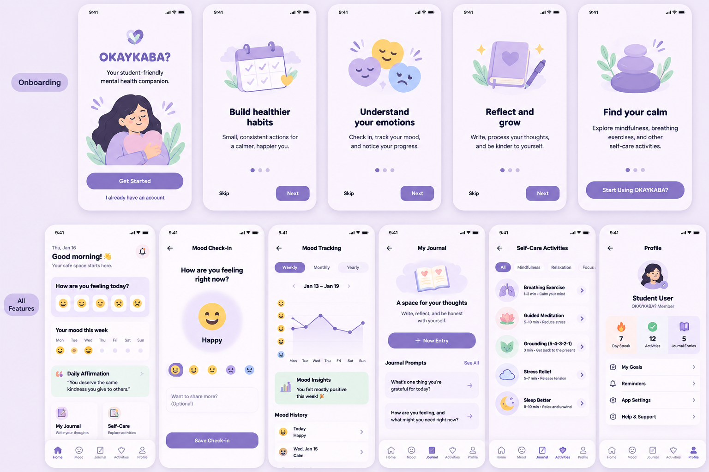

# OKAYKABA? design audit

## Scope and verdict

This is a review of the ten mockup boards supplied in this chat. The proposed journey starts with a splash and optional breathing cue, branches to account access or a demo, then reaches onboarding, Today, and the daily tools. The blue pastel boards describe the main direction. The illustrated purple board is included as a separate comparison.

**The mood orb and weekly history are a strong core. The most urgent work is defining how a student reaches Today, when a mood is actually saved, and how to leave or skip a step.** The boards show both an inline save and a sheet, but do not settle which is the default.

A student should be able to get to Today, record a mood without writing a note, and review or change the saved mood later. Android accessibility is a verification target. For the implemented app, use 48 dp touch targets and check text contrast over the actual rendered surfaces. [Android accessibility guidance](https://developer.android.com/guide/topics/ui/accessibility/apps#large-controls) · [W3C contrast reference](https://www.w3.org/WAI/WCAG22/Understanding/contrast-minimum.html)

## Steps and evidence

### 1. Opening and account choice

**Needs changes.** The wordmark and orb establish the visual identity immediately. The two breath frames say “At your own pace,” but there is no visible pause or way to advance at one’s own pace. Skip is the only visible control during motion. The account screen offers a demo, but it gives no indication of what happens to demo entries.

Make the breath optional before it starts, keep a clear direct route to account choices, and offer a static cue in reduced motion. If it runs on a timer, use copy that matches that behavior. Say what demo mode does in one line.

### 2. Sign-in, sign-up and recovery

**Needs states.** Persistent field labels and a dedicated reset route help. A large decorative orb pushes the form down. The sign-up screen simultaneously displays a submit button and a message to check email. The boards do not show invalid credentials, reset-link confirmation or an expired link.

Shrink the orb when space is tight. Show “Check your email” only after a successful request, with an action to resend or change the address. Design errors near the relevant field and show the recovery path for an expired link.

### 3. Profile setup

**Needs simplification.** Age and gender are labeled optional, but each still takes a full screen. On the age screen the progress graphic shows all three checked before the student finishes. The two separate “Skip” and “Prefer not to say” choices have no explained distinction.

Ask only for a display name during first use if needed. Move optional profile details to Account unless they have a documented purpose. Separate current from completed steps and make skipping behavior explicit.

### 4. Practice check-in and goal selection

**Promising, needs routing.** The practice-only copy is clear and the goal rows use both a radio mark and a tint. The centered bar has no step number in the visible design. “Skip” has no stated destination, and “Write a quick note” looks actionable alongside “Open Today,” with no clear indication of which opens Journal. Goal selection promises later editing, but no matching goal setting is visible in the blue Account board.

Define one destination per action and a neutral fallback when goals are skipped. Keep the practice mood out of history. Add a current-step announcement and provide a discoverable route to change the goal if the app saves it.

### 5. Today and activities

**Strong structure, needs states.** The orb, mood selector and Save button have a clear order. The partial To-do card cues horizontal scrolling. The same frame shows a saved face on today’s date alongside “Save check-in,” so the selected draft versus saved state is unclear. On the dock, only Home has a visible text label.

Add a clear draft/saved distinction and preserve the same activity order after save. Keep the partially visible next tile and offer a way to browse all activities without a swipe. Give every dock icon a name and test whether inactive icons can be identified without labels.

### 6. Log, dismiss and update mood

**Needs a decision.** The sheet has an explicit Save and edge dismissal control, and the saved state confirms the mood. However, the proposed Today screens offer the full selector inline and the sheet repeats it. The emoji for “Okay” smiles, while “Good” in the sheet and saved state uses the open smile elsewhere associated with Great.

Choose inline saving as the primary path shown on Today; use the sheet only if it replaces that interaction. Use one expression per mood across the orb, week, calendar and insights. Dismissing a draft should keep the prior saved mood intact.

### 7. Account, privacy and support

**Needs clarity.** The account screen exposes profile and privacy controls. The privacy board correctly describes the demo as device-only, but “Your journal entries … stay on this device” is easy to read as applying to signed-in users too. Talk it through simultaneously shows a composer and says AI isn’t connected; the disabled send affordance can leave the draft’s destination unclear.

Write privacy statements by mode. If entries can sync, explain when and where. Label the disconnected composer as a local draft or offer a direct Journal route. Keep support resources reachable without AI. Distinguish demo data from anything explicitly imported into an account.

### 8. Calendar and Insights

**Needs accessible detail.** The month and week views pair expressions with date positions, and the selected calendar day has a text detail card. The year grid relies on small hue-coded cells, including two similar yellows. The Monthly and Insights mockups for Nov 18 show different logged dates within Nov 12 to 18.

Back all views with the same dated entries. Expose each date, recorded mood and empty state in words, and keep a list or day-detail route available from the year grid. Distinguish future dates from past dates with no entry.

### 9. Journal, tasks, self-care and inspiration

**Promising, needs outcomes.** There is a visible primary action on each tool. Journal and Tasks show an editor or quick-add field near a floating dock, but no keyboard state. Tasks repeat the same 1 of 3 count, and checkbox versus chevron has no documented split. Inspiration has visible icons but no labels. The breathing card does not show a stop state.

Design keyboard-open and save/error states. Make the checkbox complete the task and give editing a clearly named entry point. Label icon actions for assistive tech. Show how to pause or exit a breathing session and what happens when it ends.

### 10. Alternate purple direction

**Resolve before build.** The alternate board uses five tabs, a separate Mood destination, and streak counts, whereas the blue set uses four tabs and leads with Today. Feature names and the wordmark also vary across boards.

Use the latest blue Today board as the navigation reference if that remains the chosen direction. Resolve tab labels, active-state behavior, screen names and OKAYKABA? branding before spreading them across screens. Treat the illustrated board as a separate visual direction.

## Accessibility risks to verify on device

- **Contrast over gradients.** Check Skip, helper text, field borders, selection outlines and the dock against the least favorable part of their actual background. Aim for at least 4.5:1 for regular text, with 3:1 available for large text under WCAG’s contrast criterion. The composite images do not establish a measured app contrast result.
- **Touch and alternate input.** Check the five mood labels, eye and close icons, month arrows, dock and swipe strip with Android touch targets. Dense calendar cells may need a separate list or day detail action. Check TalkBack reading order and focus return when closing the mood sheet.
- **State without color.** Expose selected mood, selected day, current onboarding step, saved mood and task completion in words as well as through the visuals. Give the editable labels and switches accessible names.
- **Motion and large text.** Test a static breathing alternative, immediate Skip, and whether larger text wraps without hiding the Save or Continue actions. Verify that the keyboard does not cover the task field or journal actions.

## Fix order

1. **Lock the first-run route.** Keep one short, optional breathing moment, then clear account and demo choices. Let new users proceed through the practice orb with an obvious Skip destination. Remove profile questions that are not needed to use Today.
2. **Specify the real check-in states.** Show unlogged, draft, saving, saved and save-error states. Update the weekly strip only after the app can truthfully show what was saved. Define editing and dismiss behavior.
3. **Test the hardest layouts.** Use Android with TalkBack, larger text, reduced motion and a software keyboard. Include low-contrast backgrounds, sparse and full calendar data, and the activity strip at small widths.

## Evidence limits

Each PNG is a byte-for-byte copy of an inspected user-supplied board. The sequences and interactions above are proposals inferred from static screens. No live navigation, persistence, authentication, contrast, target sizing, animation timing, keyboard behavior or TalkBack behavior was tested. No compliance finding is made from the mockups alone.
