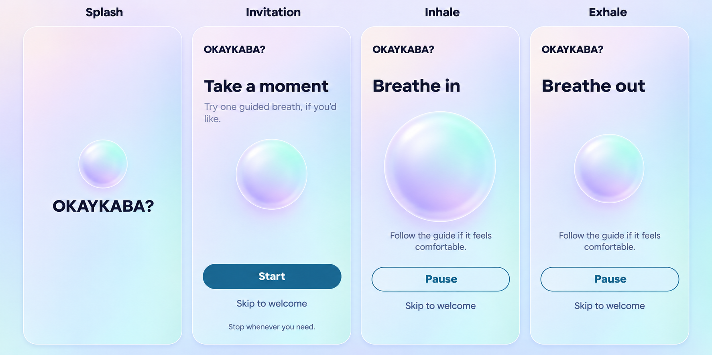
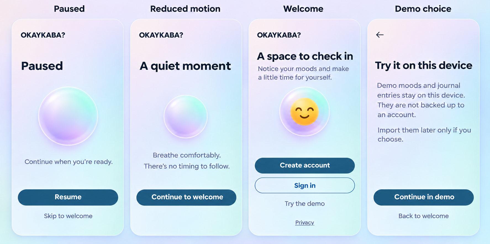
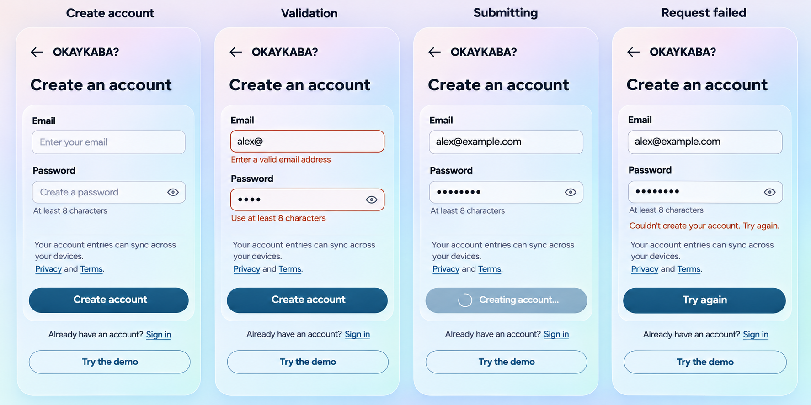
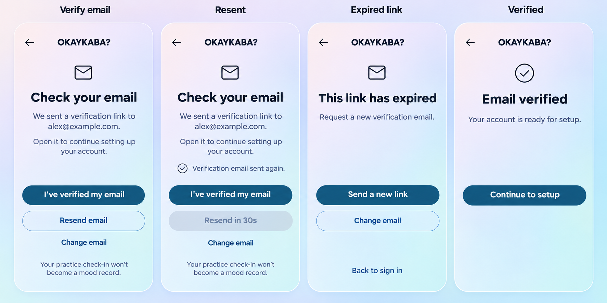
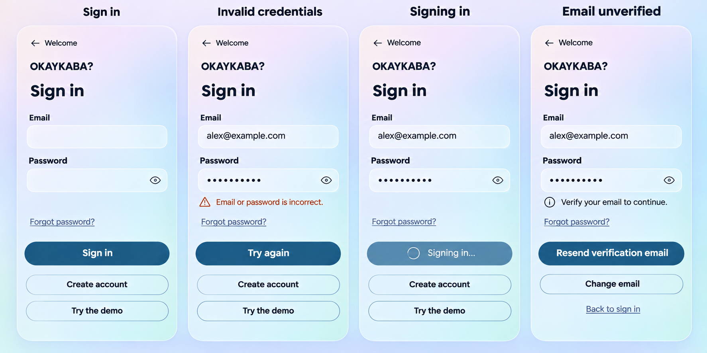
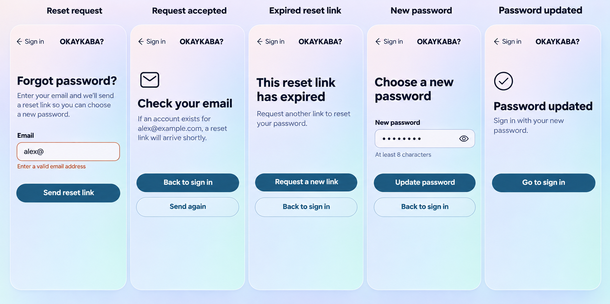
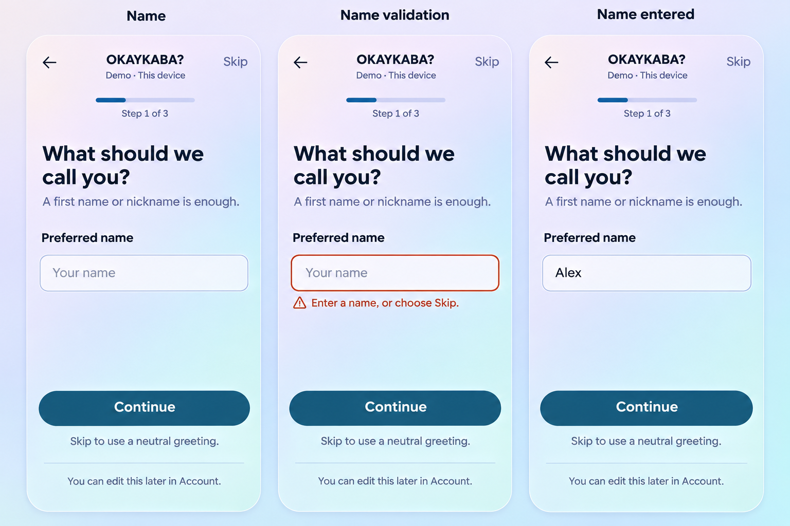
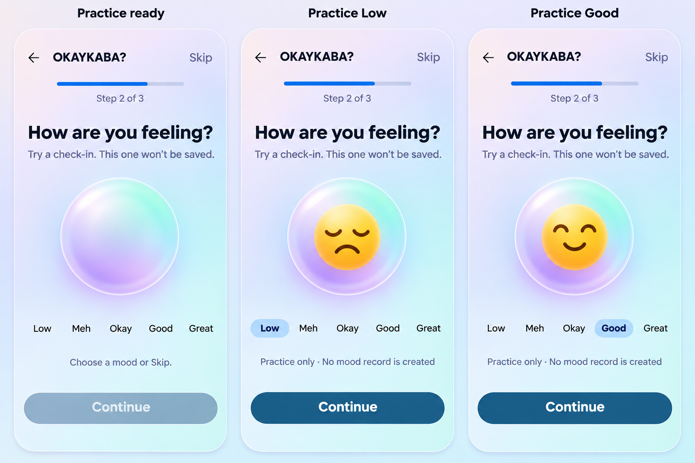
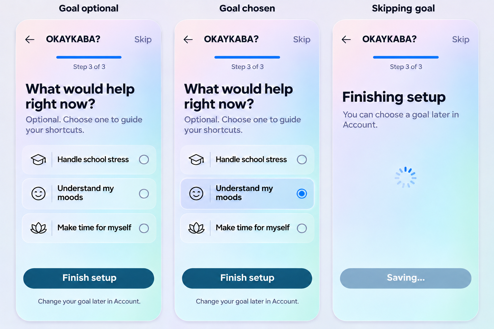
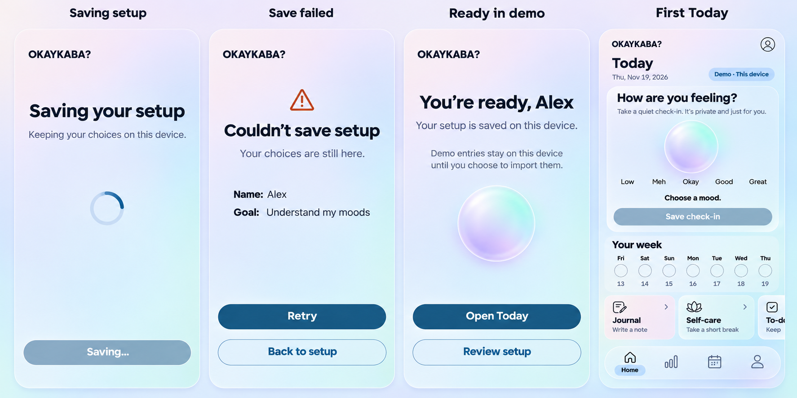

# OkayKaba revised first-run flow — design audit

Reviewed 19 November 2026. Scope: the ten revised mockup boards and their accompanying review-and-navigation.md, representing 38 panels. This is a review of proposed UI states and navigation, not a test of a running app.

## Overall verdict

The revised flow is coherent enough for a focused final design pass. Optional breathing, explicit demo privacy, unsaved practice, validation, recovery, and setup failure now have visible treatment. Resolve the account-navigation ambiguity and remaining state inconsistencies before approving the flow for implementation.

The intended journey is: splash → optional breath invitation → welcome → account or demo → preferred name → optional practice check-in → optional goal → setup completion → Today. Sign-in and recovery are branches; verification precedes new-account setup.

## Priority findings

| Priority | Finding | Evidence | Recommended correction |
| --- | --- | --- | --- |
| High | Mode-changing navigation still appears available during account requests. A late success could conflict with the user's newly chosen route. This is a proposed-state risk, not an observed runtime bug. | 3 submitting; 5 signing in; related pending controls in 9 | Define Back, Sign in, Create account, Demo, and Skip behavior while requests run. Depict unavailable controls consistently and provide a recovery path for slow or failed requests. If leaving is allowed, specify that late responses cannot redirect the user. |
| High | Change email after account creation returns to Create account in the notes. Editing a pending account address and starting another sign-up are different outcomes. | 4 pending/expired plus navigation notes | Show a dedicated pending-account Change email state with current/new address, submission, confirmation, and error. If restarting sign-up is intended instead, label and explain it explicitly. |
| Medium | Blank preferred name is treated as an error despite being optional. | 7 blank and validation | Label Preferred name (optional). Let Continue with an empty field use a neutral greeting; reserve validation for invalid entered content. |
| Medium | Verification feedback is incomplete. “I've verified my email” is shown without a checking or still-unverified panel. | 4 pending/resent | Use “Check verification”; show checking, still pending, and request-failed feedback. Advance only after verified status is established. |
| Medium | Successful completion is illustrated for demo only. Account-mode local save and cloud-sync copy remain in notes. | 10 plus navigation notes | Add account completion panels distinguishing saved locally, sync pending, synced, and failure where applicable. Keep each statement specific to its storage outcome. |
| Low | Progress-track width and header composition vary between setup steps. | 7–9 | Reuse one fixed-width progress component and header layout. Indicate current step separately from completed steps. |

## Step-by-step evidence

### 1. Splash, invitation, inhale, exhale — Healthy direction

**Strengths:** Breathing begins only after Start. Skip to welcome is explicit before and during the exercise. Pause is visible; copy avoids a fixed “at your own pace” promise.

**UX/design:** Keep splash brief and avoid replaying the introductory breath for returning users unless requested.

**Accessibility:** Expansion timing, interruption, screen-reader cues, and respect for system motion preferences require testing. The static panels establish intent only.

### 2. Paused, reduced motion, welcome, demo choice — Healthy direction

**Strengths:** Resume and Skip are clear. Reduced-motion copy has no timing requirement. Create account, Sign in, and Try the demo are distinct choices. Demo storage and explicit future import are explained.

**UX/design:** Ensure every Skip to welcome reaches this same welcome screen. Treat the static breathing alternative as an equivalent route.

**Accessibility:** Verify reading order, link targets, and contrast for Skip and privacy links over the gradient. No measured contrast result is claimed.

### 3. Create account states — Needs changes

**Strengths:** Persistent labels, password requirements, field errors, and request failure are represented.

**UX/design:** The creating-account panel greys the submit action while Back, Sign in, and Demo still look usable. Define their pending behavior using the first priority finding. Preserve entered email on failure.

**Accessibility:** Error text should be programmatically associated with its input, announced after submission, and followed by focus on the first invalid field. Give the eye control a changing Show password/Hide password name. These behaviors are unverified.

### 4. Email verification — Needs changes

**Strengths:** Pending, resend cooldown, expired link, and verified success are distinguished.

**UX/design:** Resolve the Change email route. Add checking, still-unverified, and verification-request error states. Remove the practice-check-in footer here: practice has not happened yet and it distracts from email recovery. Show the destination email and relevant resend guidance instead.

**Accessibility:** Announce resend and verification results without repeatedly announcing each cooldown second. Verify focus after returning from the email app and after link expiry.

### 5. Sign-in states — Needs changes

**Strengths:** Generic invalid-credentials feedback avoids promising whether a specific account exists. The unverified-account branch is visible.

**UX/design:** Apply the same pending-navigation policy as account creation. Make the transition from Resend verification to the verification flow explicit. Distinguish editing the sign-in email field from changing the pending account's address.

**Accessibility:** Preserve password-manager/autofill support and check password visibility, error announcements, and keyboard navigation. Screenshots cannot verify these.

### 6. Password recovery — Mostly ready for review

**Strengths:** Invalid email, generic request acceptance, expired link, new password, and successful update cover the main recovery path.

**UX/design:** Keep request acceptance distinct from proof of delivery. Shared request-failure patterns are described in the notes; ensure retry preserves the email.

**Accessibility:** Add a keyboard-open reference for forms. Confirm the focused field, inline error, and primary action can be reached without obstruction. Test reset-link routing and focus separately.

### 7. Preferred name — Needs a small flow correction

**Strengths:** A neutral greeting is explicitly available through Skip. Demo mode is identified.

**UX/design:** Empty Continue currently produces “Enter a name, or choose Skip.” An optional field should allow omission through Continue. Keep age and gender in Account, outside this first-run journey.

**Accessibility:** Use a persistent optional label and avoid treating omission as an invalid-input announcement.

### 8. Practice mood — Healthy direction

**Strengths:** No selection, Low, and Good are visually distinct; selected label and face agree. “Won't be saved” separates practice from personal history. Skip remains available when Continue is disabled.

**UX/design:** Use the same five mood faces and labels throughout Today, weekly history, and Calendar. Standardize progress-track dimensions with the adjacent setup boards.

**Accessibility:** Expose choices as a single named selection group with selected state. Avoid having the decorative orb repeat the same mood announcement. Verify comfortable hit areas for the five closely spaced choices.

### 9. Optional goal — Needs pending-state polish

**Strengths:** Goal selection is optional and the selected radio state has a visible marker. Future editing in Account is described.

**UX/design:** In the finishing/skipping panel, top Skip and Back still appear active while Saving is unavailable. Match their visual and navigation behavior to the pending policy in the notes. Goal-editing and shortcut personalization remain dependencies for the later Account and Today designs.

**Accessibility:** Announce the selected goal and saving status. Do not use the progress-track length as the only indication of position; retain Step 3 of 3.

### 10. Completion and first Today — Mostly ready; account branch incomplete

**Strengths:** Save failure retains a Retry and Back path. Demo completion states its storage scope. First Today has no selected mood and an empty week: practice is correctly absent from history. Partial activity tiles signal horizontal scrolling.

**UX/design:** Add account-specific completion and sync outcomes. Preserve a visibly empty Today until a real check-in succeeds. The later inline check-in must distinguish unlogged → draft → saving → saved/error; those full states are outside this first-run audit.

**Accessibility:** Verify accessible names for all dock icons, selected-tab state, activity-card navigation, and empty calendar days. Test that the floating dock and keyboard never cover interactive content.

## Visual system assessment

Retain the common dark ink, solid denim primary buttons, pastel background, restrained glass panels, and shared orb. The system reads consistently across most boards. Glass treatments should preserve readable text and identifiable controls as the background changes.

Use one token set for headers, progress tracks, panel padding, input boundaries, button heights, icon weights, and selected states. The clearest visible drift is the changing progress-track width across steps 7–9. Test white panel/input boundaries and muted secondary text against the actual composed background before locking colors.

## Accessibility checks before implementation approval

- Prepare one keyboard-open form and one large-text layout reference. These are missing visual checks, not demonstrated runtime failures.
- Measure contrast on the final rendered colors: WCAG's normal-text target is 4.5:1 and large text 3:1. See [W3C contrast guidance](https://www.w3.org/WAI/WCAG22/Understanding/contrast-minimum.html).
- Verify Android touch targets at runtime, especially mood choices, Skip, password visibility, and dock icons. Android recommends at least 48 × 48 dp. See [Android accessibility guidance](https://developer.android.com/guide/topics/ui/accessibility/apps#large-controls).
- Test TalkBack order, input labels, selection announcements, error association, focus after sheets/navigation, and password autofill.
- Test motion reduction, pause/resume, screen-reader breathing cues, safe areas, keyboard avoidance, and request cancellation/late results.

## Evidence and limits

All ten boards were copied into this audit folder, opened and visually inspected during this audit. Source and saved-copy hashes matched. The screenshots above are those accepted copies. Navigation intent was checked against the accompanying [review and navigation notes](../review-and-navigation.md).

These are image mockups, not an interactive prototype. No authentication requests, session verification, email delivery, data persistence, cloud sync, gestures, animation timing, screen-reader behavior, keyboard behavior, or contrast measurements were exercised. The audit makes no accessibility-compliance or implementation-readiness claim.

## Recommended next design pass

Revise only the pending-navigation policy, pending-account email change, optional blank name, verification feedback, account completion, and shared progress component. Add keyboard-open and large-text reference states. Review those changes against this report before designing the remaining app states or implementing code.

No application code was changed.
