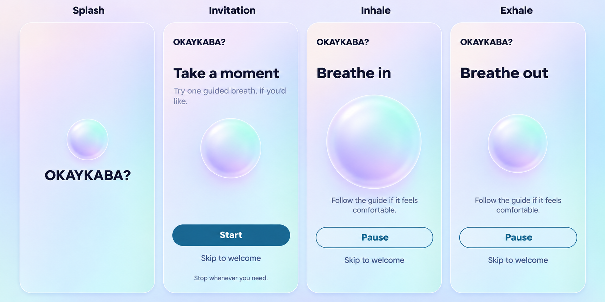
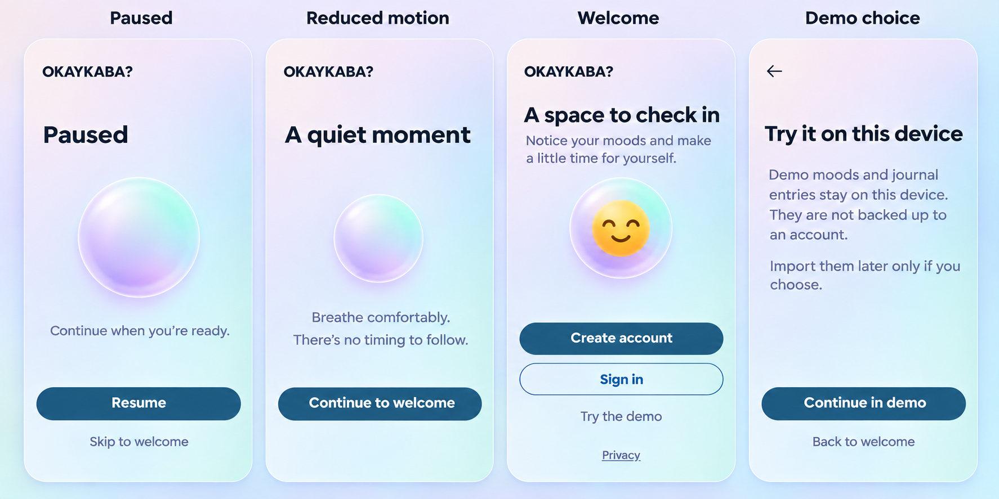
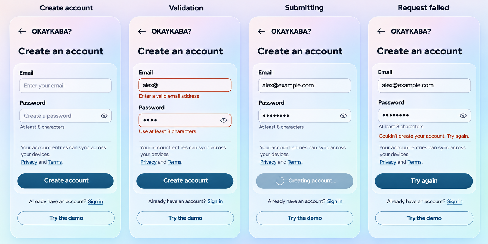
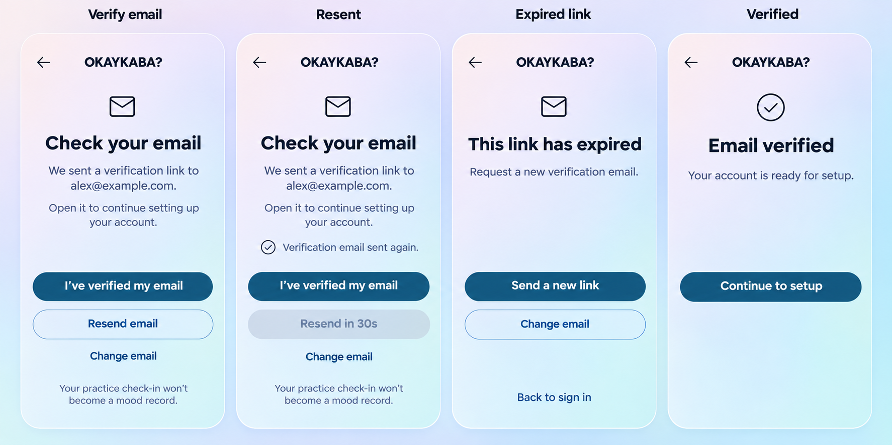
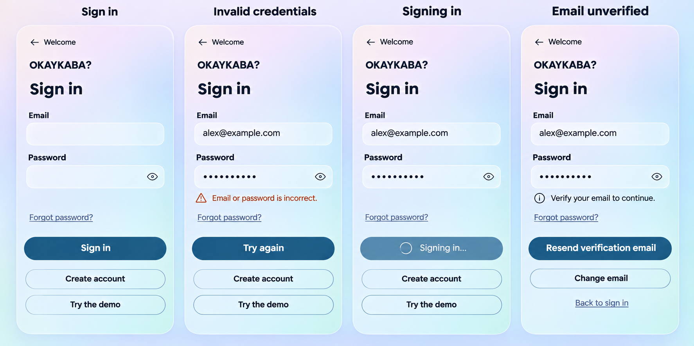
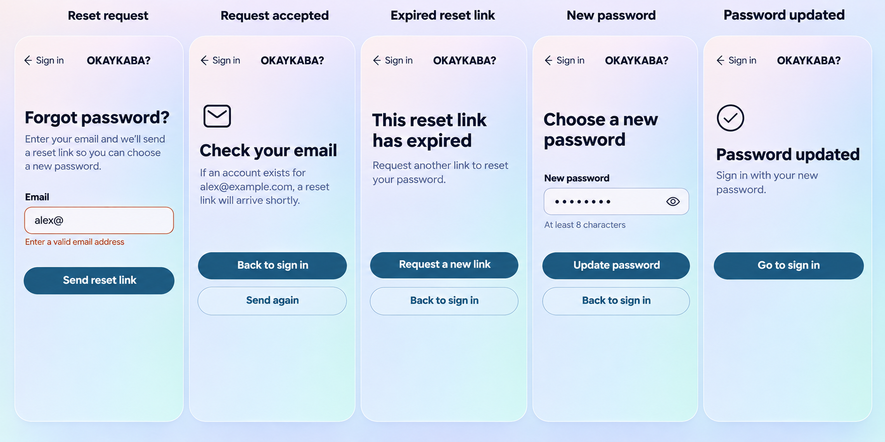
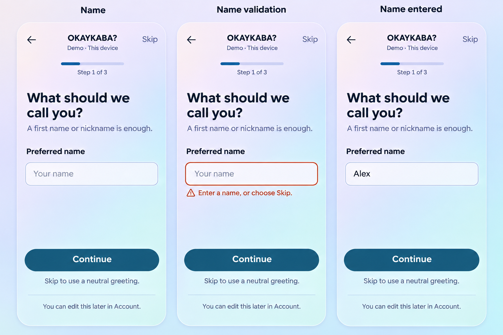
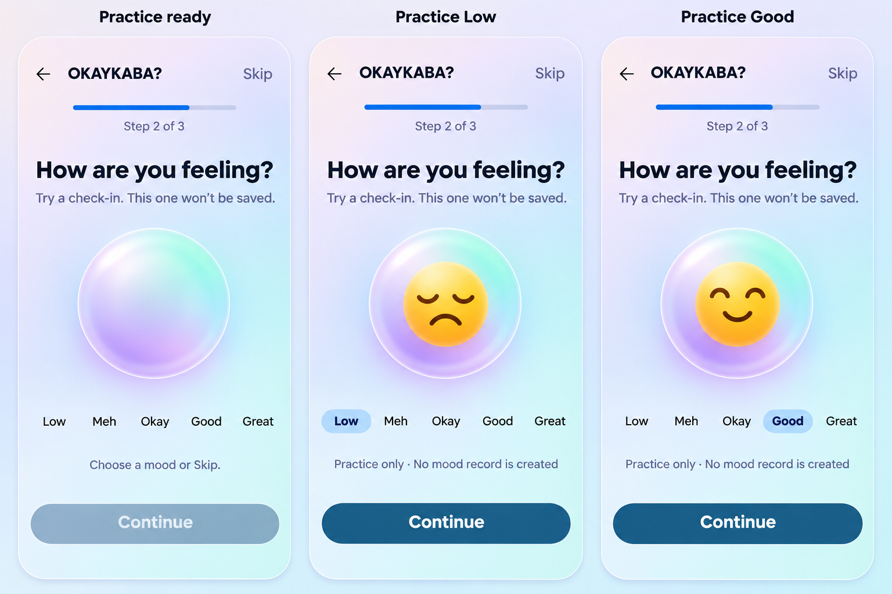
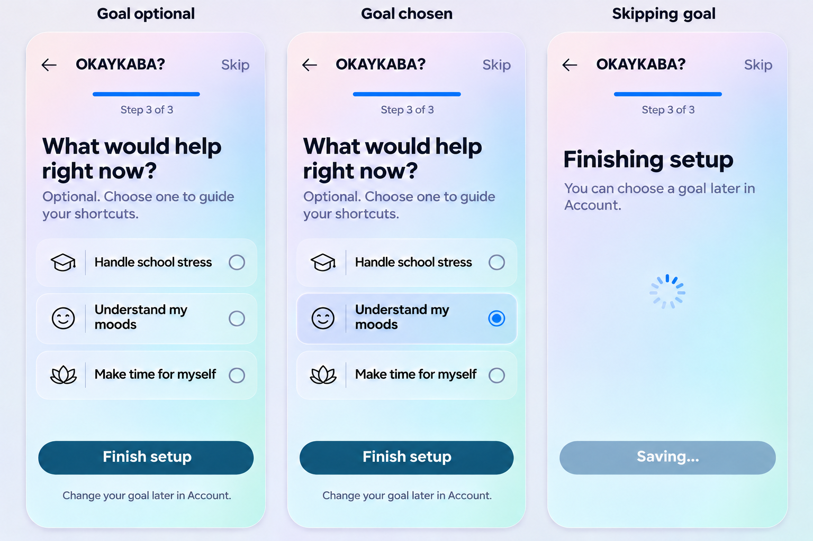
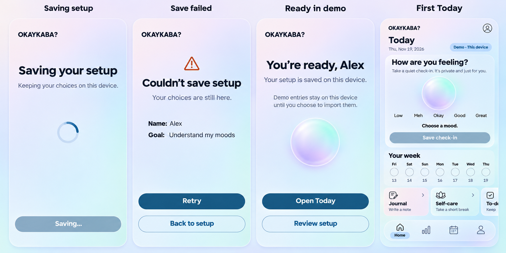

# OKAYKABA? revised first-run flow

Design review draft · November 19, 2026

One coherent flow based on the selected Option 1 Today design. The ten ImageGen boards contain 38 screen and interaction-state frames. They depict intended behavior for review.

## Review the boards

1. [opening breath](01-opening-breath.png)
2. [paused welcome demo](02-paused-welcome-demo.png)
3. [create account states](03-create-account-states.png)
4. [email verification](04-email-verification.png)
5. [sign in states](05-sign-in-states.png)
6. [password recovery](06-password-recovery.png)
7. [preferred name](07-preferred-name.png)
8. [practice mood](08-practice-mood.png)
9. [optional goal](09-optional-goal.png)
10. [completion and first today](10-completion-and-first-today.png)

## Route

**New visitor:** splash → breathing invitation → welcome → choose account or demo → preferred name → practice mood → optional goal → save setup → ready → Today.

- **Start** begins one guided breath. **Skip to welcome** bypasses or ends it immediately.
- **Create account** opens the email/password form. Successful submission leads to verification, then setup.
- **Sign in** opens the existing-account route. A completed profile returns directly to Today. An unfinished profile resumes its first incomplete setup step.
- **Try the demo** opens the device-storage explanation. **Continue in demo** enters the same short setup.
- Setup has three numbered steps: preferred name, practice mood, optional goal. The centered progress bar indicates the current step rather than a fabricated loading percentage.
- Setup completion requires a successful save. Until then, the choices remain editable in the current session.
- **Open Today** reaches an empty real check-in. A practice mood never fills the weekly history.
- After first-run completion, a returning visitor reaches their existing Today or sign-in route. The breathing introduction is available again through Self-care rather than shown on every launch.

The proposal places preferred name before the practice mood so all three setup steps have one sequence. Name, practice, and goal can each be skipped independently. This is a design decision for review.

## Navigation and state notes

### 1. Opening and breathing

- Splash exits as soon as startup is ready. Avoid an artificial wait.
- Invitation **Start** begins inhale. Prototype timing proposal is four seconds in and six seconds out, once, with no breath hold. The copy invites participation only if comfortable.
- **Pause** freezes the cue and orb at their current position. **Resume** continues from that position. Both inhale and exhale retain **Skip to welcome**.
- Completing the cycle reaches Welcome.
- System Back during the exercise returns to the invitation and stops the cue. No background animation or sound continues after leaving.
- Timing is a design proposal, not a prescribed breathing technique.

### 2. Pause, reduced motion, welcome and demo

- Reduced motion uses the static quiet-moment screen instead of automatic scaling and timing. **Continue to welcome** is always visible.
- Welcome offers Create account, Sign in and Try the demo with distinct labels.
- The welcome emoji is decorative. It does not select, infer or store a mood.
- Demo Back returns to Welcome. Demo Continue carries the device-only mode into setup.
- Privacy opens a readable explanation and returns to the prior screen. The linked document should explain demo storage, account sync and explicit import separately.
- Switching to an account later must never silently upload demo entries.

### 3. Create account

- Email and password have persistent labels. Password starts concealed. The eye action toggles visibility and changes its accessible label.
- Submit validates email and a minimum eight-character password. Invalid fields retain their text and display specific messages.
- During submission, prevent duplicate requests and show Creating account. Success leads to Verify email only when accepted by the service.
- Request failure leaves the form in place with Try again. Do not claim an address already exists unless an authenticated flow can safely disclose it.
- Back returns to Welcome. Create account ↔ Sign in preserves the email only for this flow. Never persist the password.
- Try the demo opens the demo explanation. It does not submit account details or import data.
- Terms and Privacy are proposed document links. Their content and any required consent need review before implementation.

### 4. Email verification

- **I've verified my email** checks the real verification/session state. It cannot advance solely because the student tapped it.
- Pending verification keeps the current screen and explains that verification is still required.
- Resend shows feedback only after a successful request. A cooldown is represented by 30s in the mockup. Actual availability must follow the provider's limit.
- Resend failure uses the same inline error and Retry pattern as board 3, retains the address and stays on this screen.
- **Change email** returns to Create account with the email editable and explains any needed resubmission.
- Expired verification links offer a new email or a return to sign-in.
- Verified Continue enters setup only with a valid session. If verification completes outside the app without a session, route to Sign in with a clear verification-success message.
- The practice-only footer is informational and does not mean the student has already completed practice.

### 5. Sign in

- Incorrect credentials receive one form-level message rather than revealing which credential exists.
- Signing in disables repeat submission. A connection or service failure uses an inline request-failed message with Retry and preserves inputs during the current screen session.
- An unverified account offers Resend verification and Change email. Back to sign in restores the credential form.
- Forgot password opens the recovery request with the email prefilled.
- Successful sign-in routes by setup status. It does not replay completed onboarding.
- Back returns to Welcome without starting a breathing sequence.

### 6. Password recovery

- The request example shows an invalid email. Correcting it clears the field error. A valid request shows Sending… until accepted.
- Request accepted uses the generic account-existence message in the mockup. It does not prove inbox delivery.
- Send again follows the provider cooldown and shows inline success/failure feedback.
- Expired reset links lead to a new reset request.
- New password uses the same eight-character validation, conceal/reveal control, loading treatment and inline failure pattern as account creation.
- Password updated appears only after the operation succeeds. Go to sign in returns to the credential form. Unfinished setup continues after sign-in.
- Back to sign in exits recovery. Typed passwords are not carried into another form.

### 7. Preferred name

- **Continue** on a blank or whitespace-only value shows Enter a name, or choose Skip.
- A nonempty display name advances to Practice. No email, age or gender is requested here.
- **Skip** advances to Practice with a neutral greeting. It does not invent a name or require another confirmation.
- Back returns to Welcome with the current mode and any session intact. Setup values remain available if the student resumes during this session.
- The visible Demo · This device label is the demo variant. In an account path use Account setup, not the demo privacy copy.
- Keyboard-open layout must scroll the field and error into view, retain the label and expose Continue above the keyboard. No custom OS keyboard is drawn in these mockups.
- The name can later be edited in Account.

### 8. Practice mood

- Start with an empty orb and no mood selected. Continue is disabled until a choice is made. Skip remains active.
- Selecting Low, Meh, Okay, Good or Great updates one expression and the label's selected state.
- Continue and Skip both lead to Goal. Skip discards the practice selection.
- Back returns to Name. Changing an optional display name does not create a mood record.
- Practice data stays outside real mood history. It is discarded when onboarding ends.
- Reduced motion changes expressions without scaling or pulsing the orb.

### 9. Optional goal

- Continue is named **Finish setup** here. It is enabled with or without a selected goal.
- Selecting a goal is single choice. Every activity remains available.
- **Skip** immediately clears the goal and starts completion. The third frame is the saving transition, not another confirmation step.
- Back returns to Practice with the prior name and goal choices retained.
- Goal editing belongs in Account later. A skipped goal uses the neutral default activity order.
- While saving, duplicate Finish or Skip activation is unavailable. The Back control returns to the preceding setup screen after the pending operation resolves or is safely cancelled.

### 10. Completion and Today

- Saving feedback reflects actual work and never shows fabricated percentages.
- Local save failure retains name and goal, offers Retry and Back to setup, and does not mark first-run as complete.
- In demo mode, Ready appears only when setup is saved on the device. With no name, use You're ready.
- For an account, use Setup saved on this device after local persistence. If cloud upload remains pending or fails, say Account sync pending and offer Retry sync. Do not call it synced without confirmation. A local setup can still open Today with truthful pending-sync feedback.
- **Review setup** returns to Name with choices intact. Edits must be saved again before completion.
- **Open Today** shows the selected Option 1 inline check-in with an empty orb, no selected mood, disabled Save check-in and empty weekly cells for a new user.
- Returning accounts show actual existing entries. Never erase real entries to match an empty mockup.
- The main mood save states already selected in Option 1 remain the later screen-state reference.
- The first Today frame uses Nov 19, 2026 as a sample. Actual dates and week cells follow the user's local date and timezone.

## Shared interaction rules

- Back follows the previous meaningful screen, not a restart of the whole introduction. Screen transitions preserve only appropriate in-session input.
- Skip is step-specific. It never silently accepts a mood or uploads demo content.
- Form submission shows immediate feedback, a single pending action and a recoverable error beside the form.
- Reusable state patterns in boards 3–6 apply to verification checks, resends, reset requests and updates even where every repeated transient combination is not separately drawn.
- Disabled controls still need an explanation or a visible alternative. The practice screen retains Skip, and the first Today screen says Choose a mood.
- Persistent field labels, text error messages and selected-state announcements accompany color.
- Proposed Android targets are at least 48 dp. Test full text enlargement, TalkBack order, keyboard clearance, reduced motion and reduced transparency later. These static boards do not verify them.
- The progress bars show the current step. Use equal centered track widths across name, practice and goal in final component design.
- At narrow sizes, group the five mood options into a wrapping control if needed rather than shrinking their labels or targets.

## Review notes

- This draft was created with the built-in ImageGen tool. It contains generated artwork and example text, not a working application or verified authentication flow.
- Account state variations intentionally use form and envelope icons instead of repeated decorative mood orbs.
- Decorative backgrounds, exact bar widths and stroke weights can vary slightly between generated boards. The shared type, color and component rules above are the source for the eventual detailed specification.
- All boards are saved locally. No product source was edited for this design pass.
- Still to review: preferred name before practice, exact breathing timing, account verification wording and whether the optional goal is useful enough to retain.

## Prompts

The corresponding image-generation prompts are saved in [imagegen-prompts.md](imagegen-prompts.md).
