# OkayKaba revision 2 — UX, design and accessibility audit

**19 November 2026 · Static first-run mockups · Design review only**

## Scope and user goal
Reviewed the twelve saved boards below (46 panels) and [navigation notes](navigation.md). Goal: let a student choose an optional quiet moment, choose account or demo, complete or skip lightweight setup, and understand what was saved before entering Today.

Every board was opened from this revision folder and inspected in the current audit. The three unchanged boards are included because they remain part of the requested revised flow. Generated preliminary variants were corrected before this final evidence set.

## Verdict
The first-run structure is ready for a design review. The principal flow contradictions are addressed. This is not a final accessibility sign-off or a pixel-exact component handoff: progress geometry and enlarged-text asset consistency remain visible polish items, and several shared secondary errors are specified rather than separately pictured.

## Five requested corrections
| Correction | Result |
| --- | --- |
| Back, Skip and Demo during requests | Explicit Leave action replaces conflicting pending navigation in the newly drawn pending states. Notes define immediate departure, late-result suppression, and mode switching. |
| Change email and verification states | Dedicated pending-account address update, check pending/failure, expiry and verified outcomes. Some address-update errors use the shared pattern in notes. |
| Optional preferred name | Blank Continue and Skip both advance with a neutral greeting; no omission error. |
| Device save versus account sync | Five separate completion outcomes, with no fake percentages or automatic demo import. |
| Progress, keyboard and larger text | One shared progress specification, revised setup tracks, keyboard-open and reflow boards. Raster widths vary slightly; actual text scaling remains unverified. |

## Strengths
Breathing starts only after consent. Demo privacy remains specific to demo. Practice is clearly unsaved and cannot populate history. Account creation, verification and setup are separate stages. Request failure never masquerades as successful saving. A cloud failure does not block access to locally saved setup.

## Remaining UX and design findings
1. **Medium — Additional email-update errors are not separately pictured (step 5).** Before implementation handoff, draw invalid new address, unauthorized/expired pending-account session, failed update and resend failure using the defined shared pattern. Do not create a duplicate signup as recovery.
2. **Medium — Account request departure is a design contract, not tested behavior (steps 3, 4, 6, 10).** The Leave wording is honest that work may finish. The later prototype must prove that a late account response cannot override an explicitly chosen demo mode.
3. **Low — Progress geometry varies (steps 8–10 and 12).** Header order and semantics are consistent, but widths, offsets and shades are not pixel-identical. Reuse the specified 180 × 6 logical-pixel track, with one shared header component. Do not measure production tokens from these generated rasters.
4. **Low — Returning-user wording and delivery promise (steps 6–7).** Prefer “Account” on sign-in, and “If an account exists, we've requested a reset email. Delivery may take a few minutes” only after acceptance. Do not guarantee inbox delivery.
5. **Low — Enlarged-text faces differ (step 12).** Replace outlined mood-control faces with the same five expression assets used throughout the app, preserving the wrapped layout. Keep the orb decorative when the selected choice already announces its mood.

## Accessibility assessment
Visible strengths: persistent input labels, text errors, explicit optional fields, selected mood/goal treatment, a motion-reduced path, and a keyboard-clearance concept. These address design intent only.

Risks and required later checks:
- Thin input boundaries and muted secondary text over a changing gradient need measured contrast, including focused/error/disabled states.
- Mood rows, icon buttons, Skip and Back need target-size measurement and TalkBack labels/selected states.
- The enlarged-text sheet is a reflow concept, not proof of functioning 200% system text. Verify all labels and controls, not just headings.
- Check screen-reader focus after navigation, first-invalid-field focus, error associations, status announcements, and return from external email.
- Verify keyboard avoidance, system Back, safe areas, landscape/reflow, password autofill, reduced motion and pause/resume on Android.
No contrast failure, target-size failure or accessibility compliance is asserted without those measurements.

## Numbered screenshot evidence
### 1. Opening and optional breathing — Strong

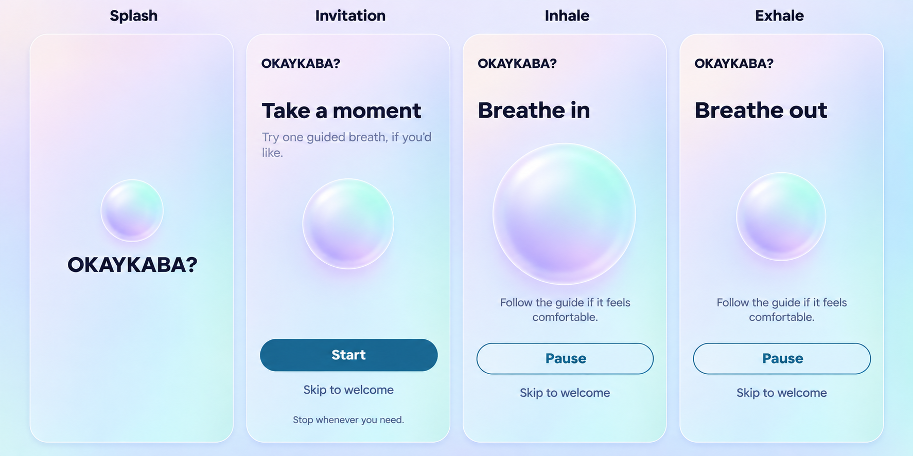

Breathing is opt-in; Start, Pause and Skip are explicit. Reduced motion is supplied in the next board. Timing and accessible cues remain untested.

### 2. Welcome and demo choice — Strong

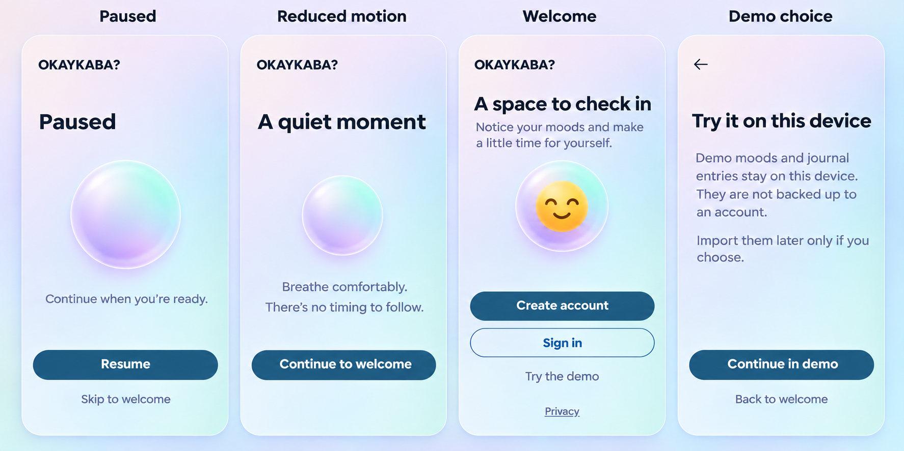

Account, sign-in and demo paths are distinct. Demo storage and explicit import are described. The decorative smile must not preselect a mood.

### 3. Account creation — Improved; confirm recovery route

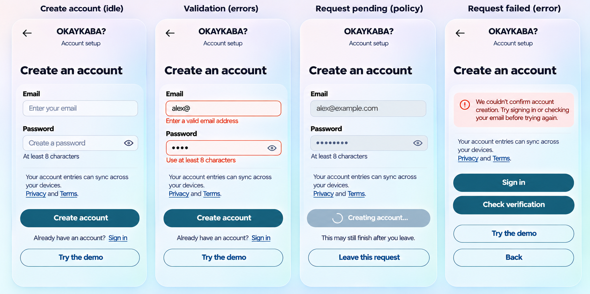

Pending has one Leave action and warns that the request can still finish. Validation is specific; uncertain outcome avoids blind duplicate creation. Checking verification without an active session needs the safe, generic service route described in navigation notes.

### 4. Verification checking — Strong direction

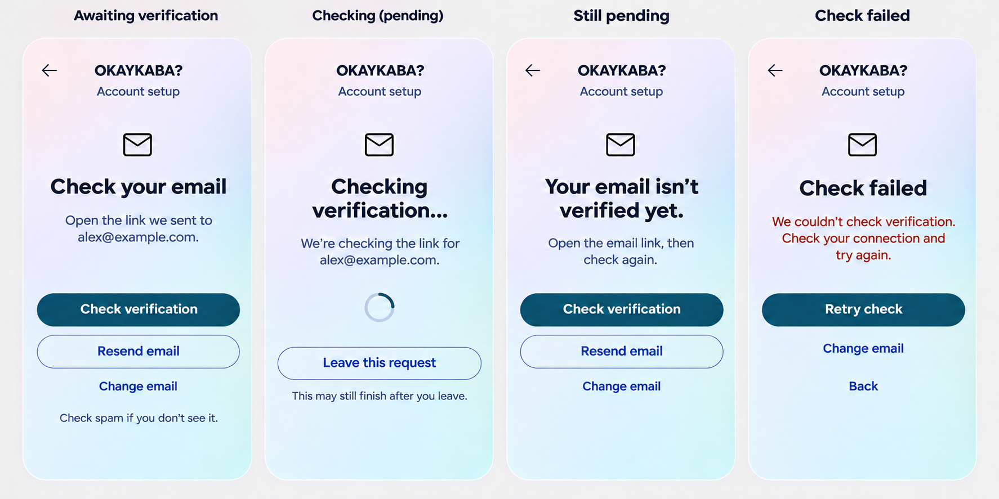

Awaiting, checking, still pending and failed are visibly separate. No setup bar or Skip appears in verification. Error remains in account context. Resend sending/failure and return-from-email focus are specified in notes, not separately illustrated.

### 5. Change email and link outcomes — Needs detail before handoff

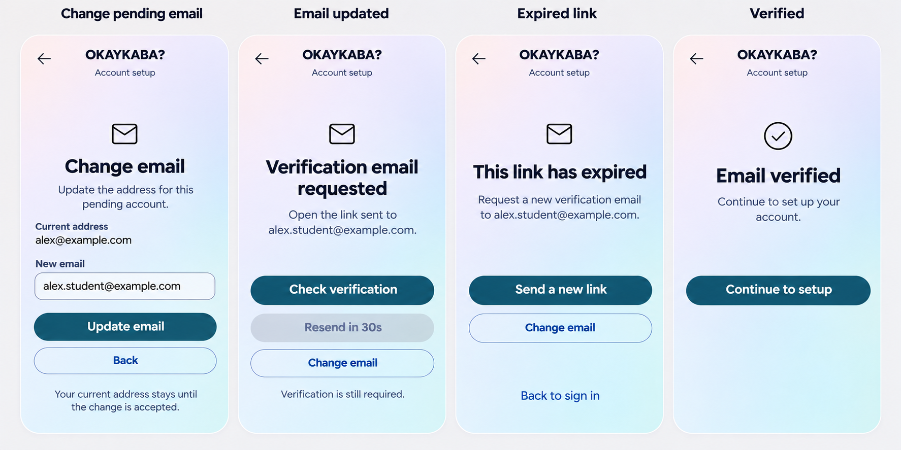

Change email now edits the pending account rather than starting another signup. Expired and verified outcomes are distinct. Address-update validation, authorization failure and request-failed panels are described through shared patterns but not separately drawn. Their service authorization remains a later dependency.

### 6. Sign-in — Improved

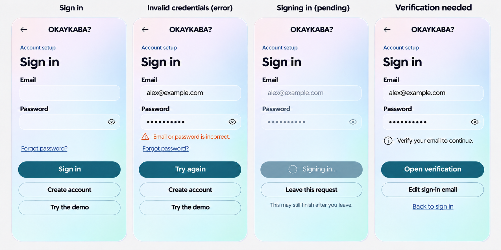

Pending has no competing Back, Create account or Demo action. Verification-needed uses Open verification; Edit sign-in email is clearly a credential edit. 'Account setup' is slightly imprecise for returning users; 'Account' would be clearer in this branch.

### 7. Password recovery — Mostly ready for review

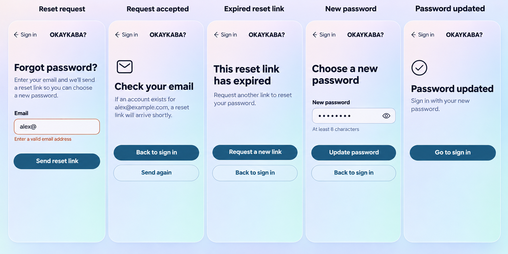

Invalid email, generic acceptance, expiry, replacement password and success are covered. This retained board uses the new pending/leave policy by specification; it does not separately picture reset-request pending and network errors. Accepted copy 'will arrive shortly' could be softened to avoid a delivery-time promise.

### 8. Optional preferred name — Strong interaction; geometry polish

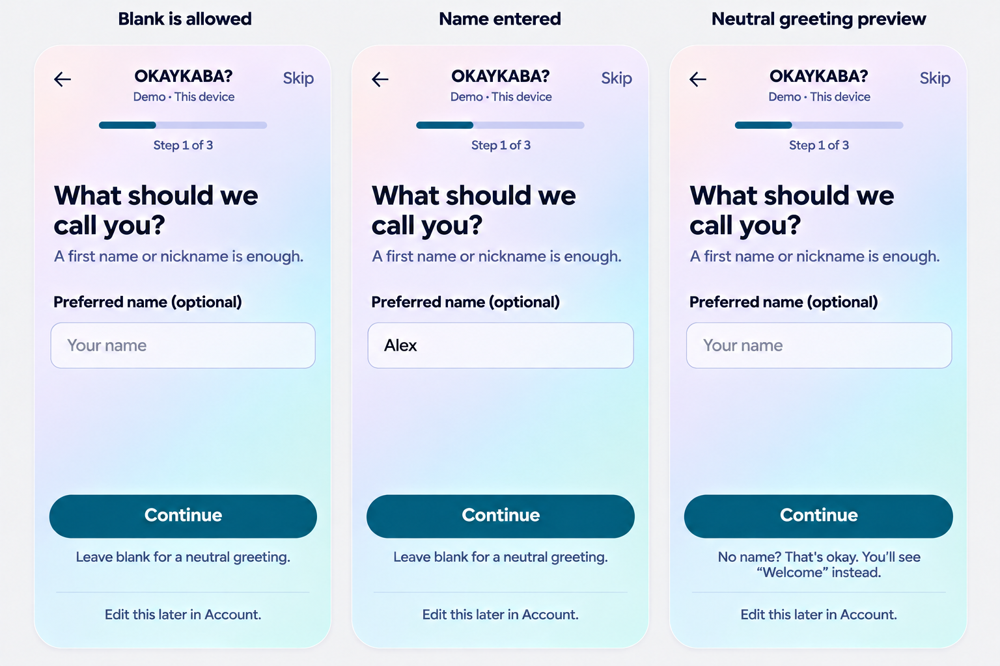

Blank Continue is enabled and no omission error remains. Neutral greeting is explicit. Track width was revised; residual raster geometry still differs from adjacent boards. Use the one shared component specification for the next precision-design pass.

### 9. Unsaved practice — Strong interaction; visual consistency follow-up

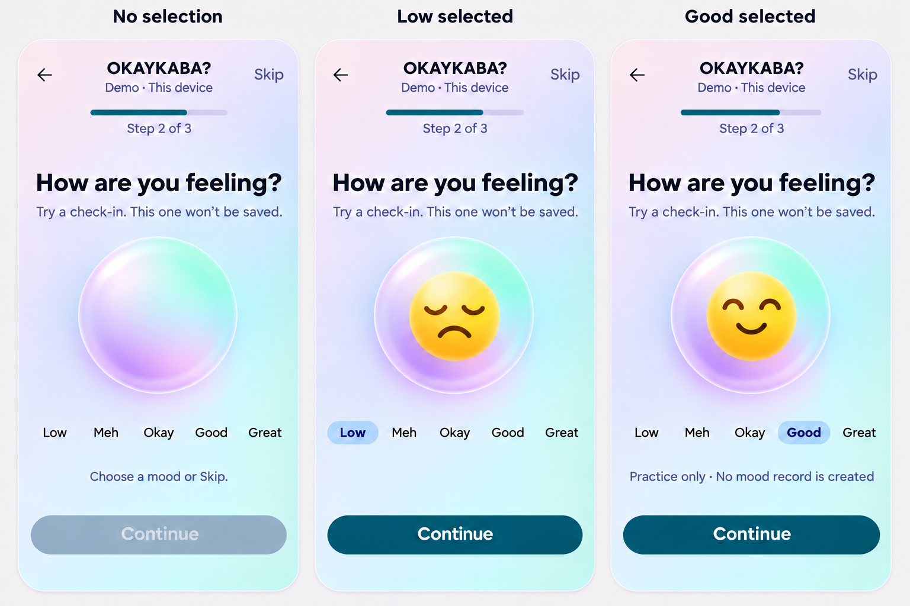

Practice starts empty and labels match Low/Good expressions. Continue and Skip behavior is defined. Practice cannot enter history. The normal five-option row still needs measured touch-target validation; the enlarged-text board shows the wrapping alternative.

### 10. Optional goal and local save — Improved; geometry polish

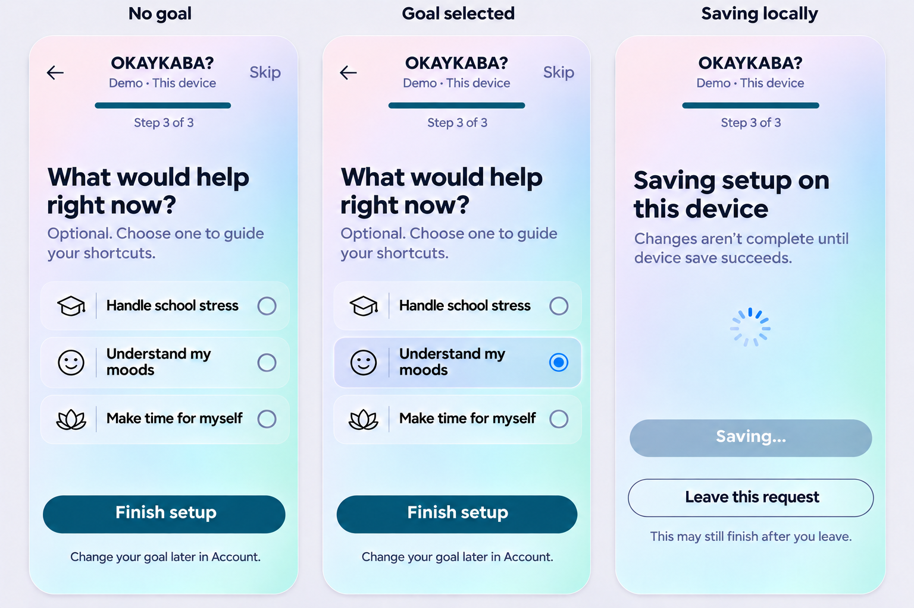

Finish setup allows omission. Device saving replaces Back/Skip with an explicit Leave action and makes no completion claim before save succeeds. The three numbered steps consistently represent position, not successful saving. Track dimensions remain approximate in generated art.

### 11. Completion and sync outcomes — Strong storage-state distinction

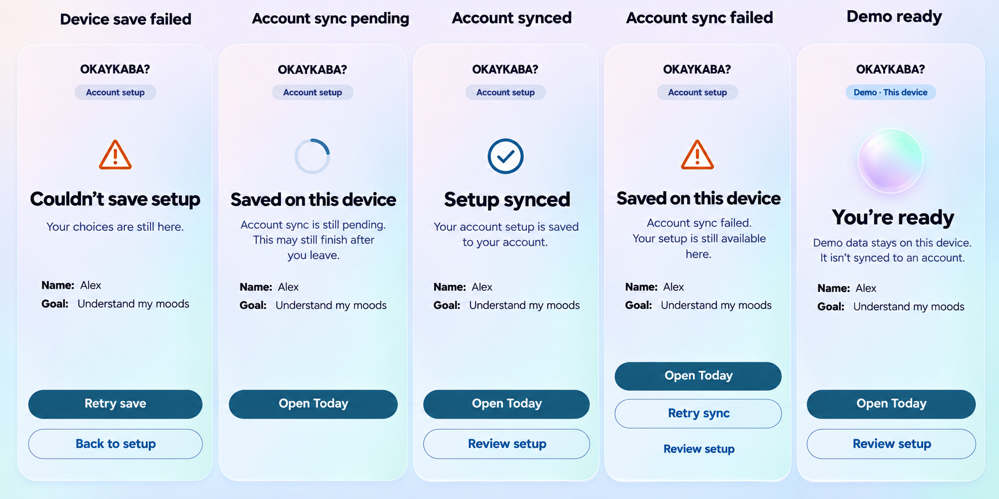

Device save failure, account sync pending/success/failure, and demo readiness are separately illustrated. Open Today remains available after local success. Pending cloud sync omits Review setup, so its editing route is later through Account; notes reflect this. This is a design proposal, not evidence that sync works.

### 12. Keyboard and enlarged text — Useful concept; needs device verification

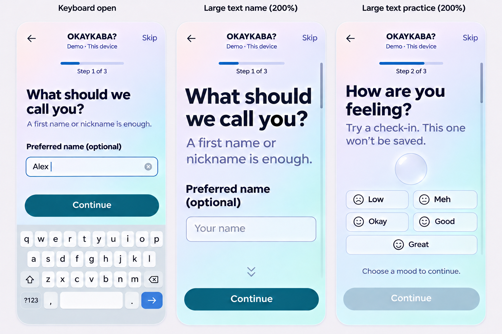

Continue is above the schematic keyboard, headings wrap, and practice choices reflow. The '200%' captions describe intended enlarged-text scenarios, not a measured font-scale test. Some small header/choice text has not visibly doubled; outline mood icons also differ from the yellow orb expressions. Use the same five expression assets and verify actual text scaling later.

## Evidence limits
This audit uses static mockups and route specifications. It did not run the app, contact an auth provider, send email, save data, exercise cloud sync, or test gestures, animation, keyboard behavior, actual text scaling or assistive technology. No mobile-device or browser runtime claim is made. The review gallery is a document containing images, not an app prototype.

## Review recommendation
Review the route, request-exit wording and account/demo storage distinction now. Keep the remaining visual polish and secondary-error panels on the first-run handoff checklist. After approval, the next separate design task is Today's unlogged → draft → saving → saved/error check-in states, then Journal and Mood Calendar. Those screens were not started here.

No app source was changed and nothing was pushed to GitHub.
