# Review the revised first-run flow

**Revision 2 · Option 1 · Mockups only**

[Navigation and state notes](navigation.md) · [Audit](audit.md) · [ImageGen prompts](imagegen-prompts.md)

Start with the screens below in order. Account verification and recovery are branches; everyone reaches the same short setup in the selected account or demo mode.

**Splash → optional breath → Welcome → Account/Demo → Name → Practice → Goal → Save → Ready → Open Today**

Pending actions have one explicit exit, optional name accepts blank Continue, and completion distinguishes device saving from cloud syncing. These are proposed interaction states, not a working prototype.

## 1. Opening and optional breathing

Start begins breathing; Pause freezes it; Skip opens Welcome. Back stops the cue.

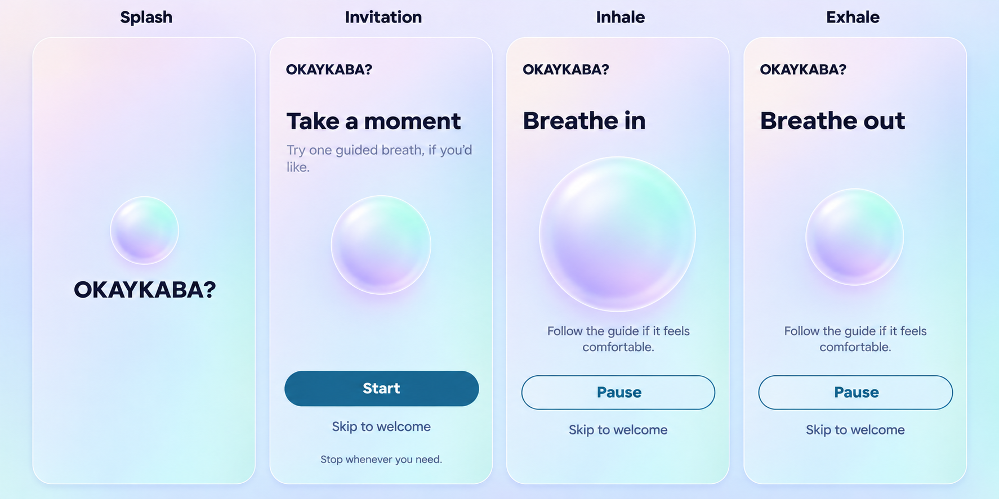

## 2. Welcome and demo choice

Resume or take the reduced-motion route. Choose Create account, Sign in, or an explicitly device-only demo.

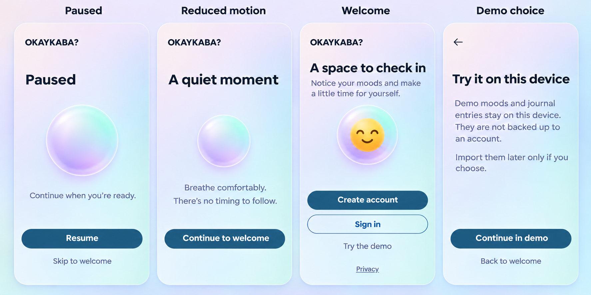

## 3. Account creation

Field validation, pending request, and uncertain failure. Leave before switching mode; do not duplicate account creation.

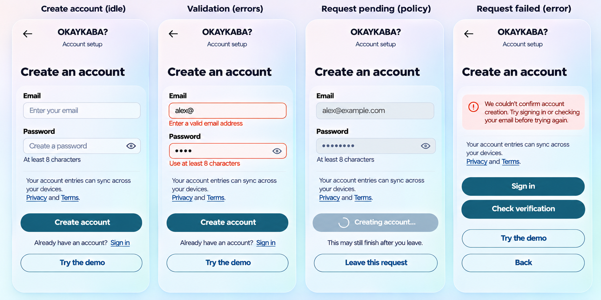

## 4. Verification checking

Awaiting → checking → still pending or failed. A tap alone cannot verify an account.

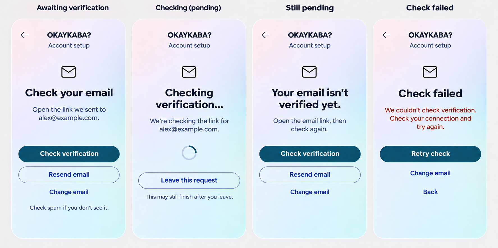

## 5. Change email and link outcomes

Update a securely authorized pending account; show new destination only after acceptance. Recover expired links; continue after actual verification.

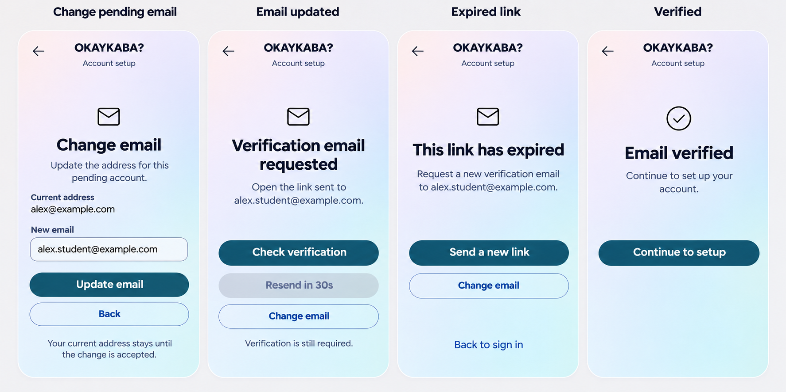

## 6. Sign-in

Idle, invalid credentials, pending, and verification-needed branches. Editing credentials is separate from changing an account address.

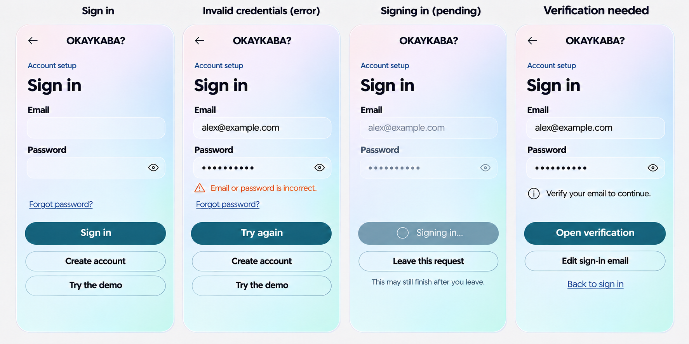

## 7. Password recovery

Validation, request acceptance, expiry, new password, and successful update. Shared pending policy applies.

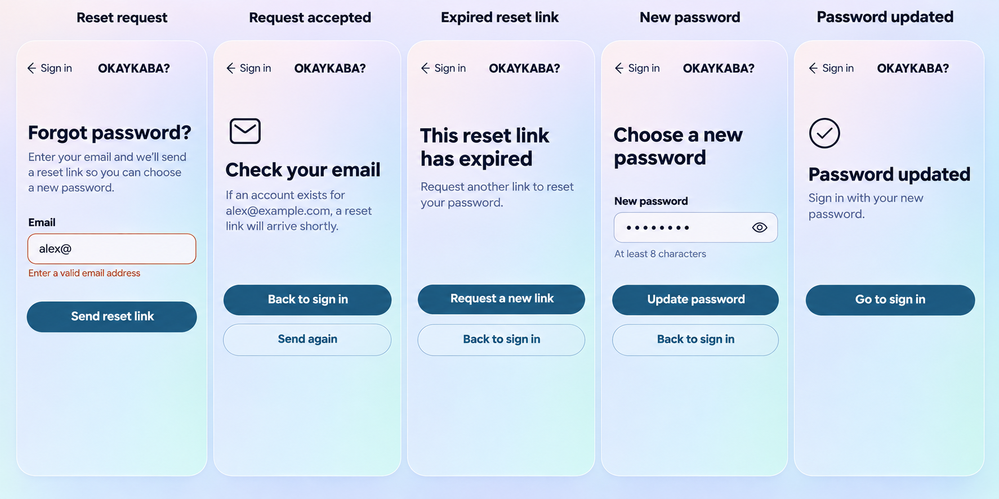

## 8. Optional preferred name

Blank Continue and Skip both use a neutral greeting. No empty-name error.

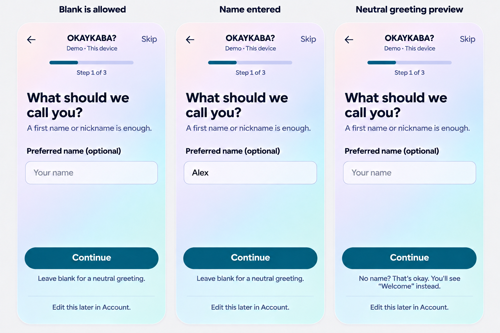

## 9. Unsaved practice

Select a mood or Skip. Practice never enters history. Back returns to Name.

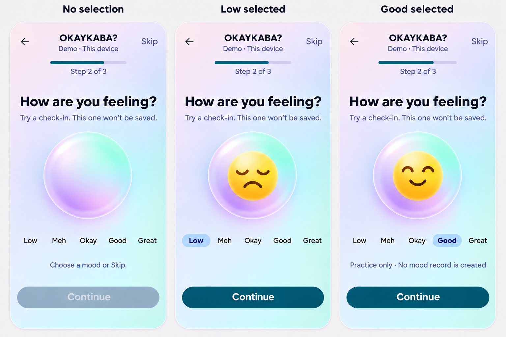

## 10. Optional goal and local save

Finish without a goal or Skip. Pending save exposes Leave this request, with no competing Back/Skip.

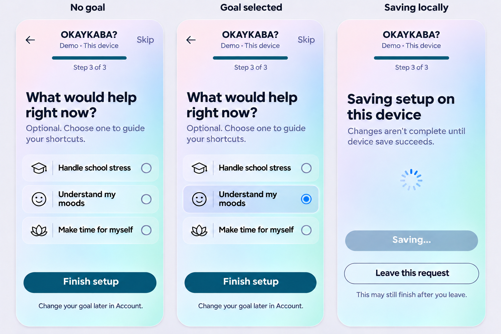

## 11. Completion and sync outcomes

Device failure, account pending/synced/failed, and demo ready are distinct. Open Today is available after successful device saving.

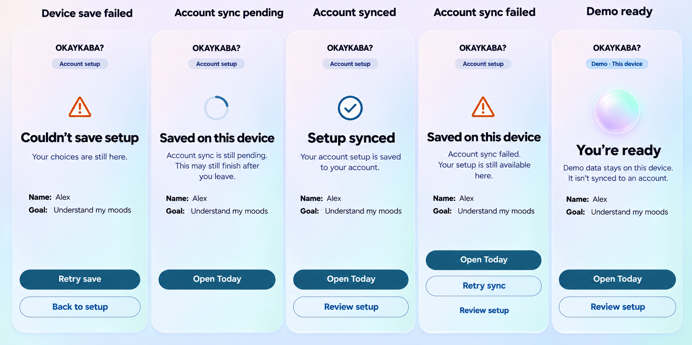

## 12. Keyboard and enlarged text

Continue above keyboard; scrollable enlarged text; wrapped mood choices. Runtime accessibility remains untested.

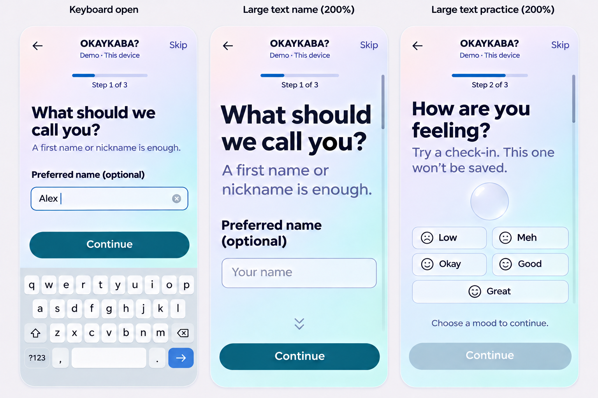

## Design review

Please review the first-run order, the request-exit wording, and the separate account/demo privacy messages. The audit records remaining visual or state-coverage limitations. No Today save-state, Journal, or Mood Calendar redesign has started.
