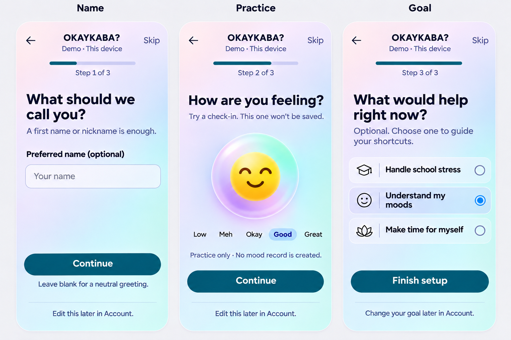
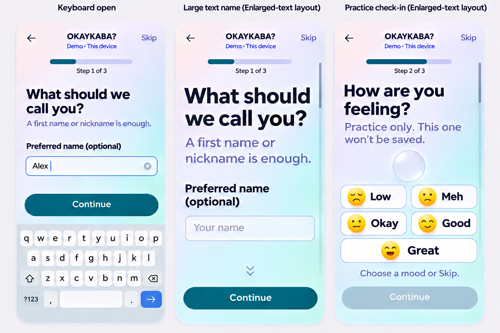
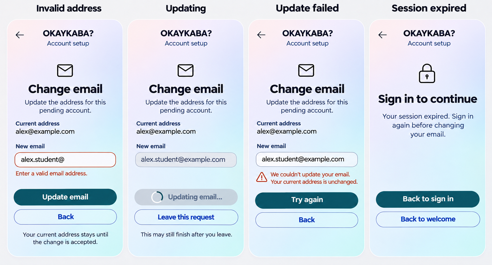

# Scoped audit — first-run revision 3
19 November 2026 · Mockups and navigation notes only

## Scope, goal and evidence
Reviewed the three saved revised boards (ten panels) below and [navigation/component notes](navigation-and-components.md). The goal is to remove the remaining first-run inconsistencies while preserving Option 1 and giving a student understandable recovery from an email-change problem.

All three selected PNGs were opened from this folder and inspected in this audit. The enlarged-text board was inspected again after its final header edit. The image copies were checked against their generated sources. This is a scoped review of the three requested refinements, not a new audit of every unchanged first-run screen.

## Verdict
Ready for design review. The three requested details are represented: one shared progress treatment, one yellow mood-expression family at enlarged text, and four explicit email-change states. No additional first-run route is introduced.

The exact component dimensions in the notes remain the precision specification. The generated raster boards illustrate geometry and state; they are not verified pixel-exact production components or export-ready mood assets.

## 1–3. Shared setup header

| # | Panel | Health | Visible finding and navigation check |
| --- | --- | --- | --- |
| 1 | Name | Strong | Track sits in the common header row; blank optional input has enabled Continue. Continue/Skip advance with a neutral greeting. |
| 2 | Practice | Strong | Header follows the same order and track treatment. Good face matches selected Good label. Unsaved-practice copy stays explicit. Back returns to Name; Continue/Skip lead to Goal. |
| 3 | Goal | Strong | Same header/track treatment with final-step position. Finish setup and optional goal remain clear. No saving percentage is fabricated. |

**Strengths:** Shared placement and visual weight reduce shifts in orientation. Step labels supplement fill length. Spacing and typography do the main work; no extra material effect is introduced.

**Design constraint:** Use the specified common 180 × 6 logical-pixel track and one shared header container for all state variants. Do not derive exact production dimensions from the generated pixels. Text enlargement may increase the header's height as a group; controls must not overlap.

**Later checks:** Actual focus order, selected-state semantics, measured target sizes, and narrow/translated layouts require a prototype. The normal five-choice mood row still needs real touch-target measurement.

## 4–6. Keyboard and enlarged-text layouts

| # | Panel | Health | Visible finding and navigation check |
| --- | --- | --- | --- |
| 4 | Keyboard-open Name | Clear layout intent | Field label and input remain visible; Continue is above the schematic keyboard. First Back dismisses keyboard; subsequent Back navigates. |
| 5 | Enlarged-text Name | Clear reflow intent | Heading and optional label wrap. Scroll cue and reachable Continue preserve the route without shrinking text. |
| 6 | Enlarged-text Practice | Improved | Low/Meh have distinct frowns, Okay a straight mouth, Good a small smile and Great an open smile, all in the same yellow material family. Choices wrap; Skip is visible; disabled Continue has an explanation. |

**Strengths:** The mismatched outline-face set is removed. Mood meaning is expressed through the face and label. White choice surfaces provide restrained, legible separation without extra translucent layers.

**Limits:** The schematic keyboard is not evidence of actual keyboard avoidance. “Enlarged-text layout” correctly avoids claiming a tested 200% system setting. Header and control text must also respond to real font scaling; large headlines alone do not prove accessibility. Reuse the actual exported five-face asset set in a later detailed design, rather than independently regenerating each occurrence.

**Later checks:** TalkBack group/choice names, selected-state announcements, long labels, font scaling, full scroll reachability, keyboard resizing and focus visibility.

## 7–10. Change email errors and departure

| # | Panel | Health | Visible finding and navigation check |
| --- | --- | --- | --- |
| 7 | Invalid address | Strong | Persistent New email label and written validation error; current address stays visible. Correct then resubmit, or Back to Verification. |
| 8 | Updating | Strong pending pattern | Fields and submit look unavailable; only Leave this request is offered. Copy acknowledges that work may finish after departure. |
| 9 | Confirmed update failure | Clear with scoped meaning | Typed replacement address is retained, icon and text explain failure, and Try again/Back provide recovery. “Unchanged” applies only after confirmed rejection. |
| 10 | Expired session | Clear recovery | Reauthentication is required; no Retry update or duplicate-signup action. Back to sign in resumes only after authorization; Back/top arrow to Welcome exits. |

**Important distinction:** A timeout or lost response cannot prove that the old address is unchanged. The notes specify separate uncertain-outcome copy and reconciliation before retry. The failure panel must never be used for an ambiguous timeout.

**Privacy and navigation:** No demo-only claim appears on these account screens. A session-expired user cannot mutate the pending identity. Leave cannot promise to cancel a server operation; late responses must not redirect the student or replace newer choices. These are required behaviors for a future prototype, not verified service behavior.

## Accessibility and material guidance
The notes specify a solid warm-white fallback for reduced transparency, high contrast, unsupported blur or a busy backdrop. It retains dark text, boundaries, focus and geometry. The reduced-motion alternative removes orb scaling and large translations, uses stable states, and permits static loading text.

These alternatives are specified, not runtime-tested or separately rendered in this focused revision. Measure final contrast, disabled-control readability, error association and focus visibility against actual rendered surfaces. Do not claim accessibility compliance from these images.

## Remaining verification and recommendation
No new blocking contradiction was identified within this scoped set of mockups and notes. Review the three boards before approving first-run. Later testing must exercise real text scaling, keyboard behavior, TalkBack, Back/cancellation, reauthentication, network uncertainty, request ordering and backend address reconciliation.

No app source was changed, no backend operation was performed, and no other app screens were started.
