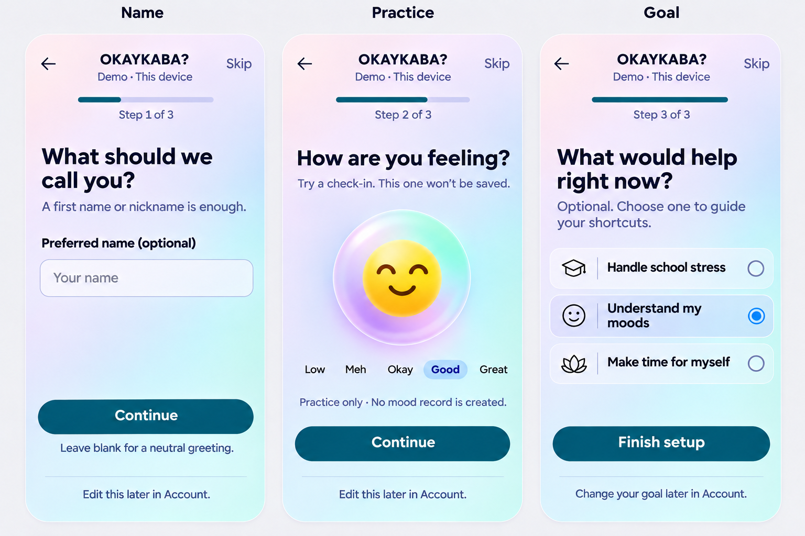
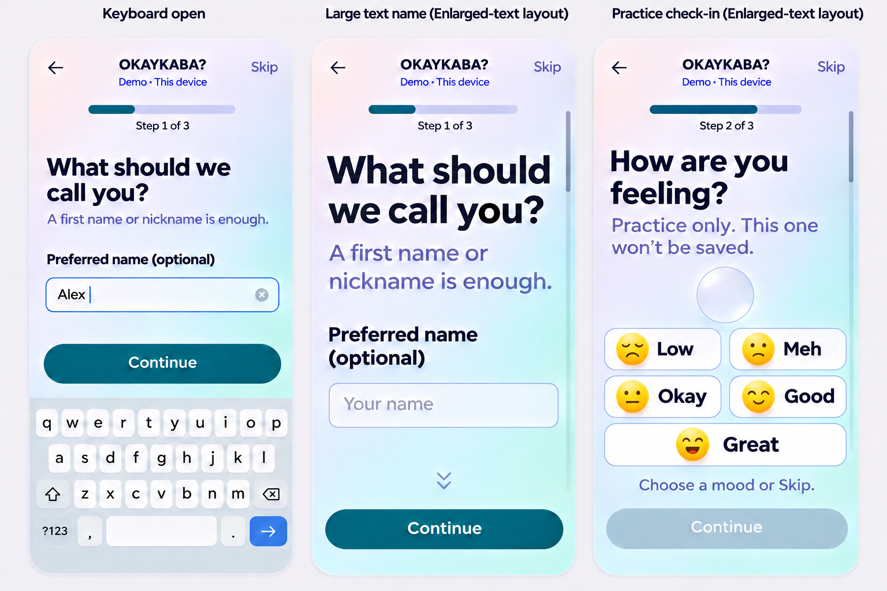
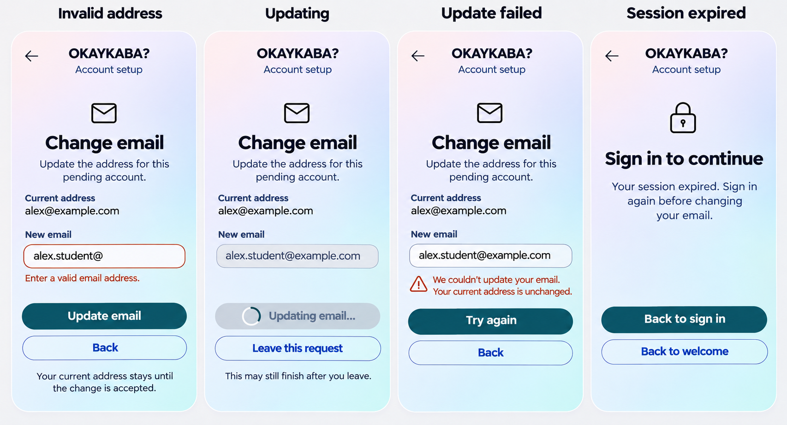

# OkayKaba first-run refinement — revision 3

**One coherent revision · Option 1 preserved · Mockups only**

[Open the review gallery](review.html) · [Navigation and component specification](navigation-and-components.md) · [Scoped audit](audit.md) · [ImageGen prompts](imagegen-prompts.md)

This focused revision supersedes only the header, enlarged-text mood treatment and Change email error coverage from revision 2. The [earlier full flow](../v2/review.html) supplies the unchanged route and screen states; its older geometry and mood icons are superseded here.

## 1. Shared setup header

Name, Practice and Goal share the same progress treatment. Blank-name continuation, unsaved practice and optional goal behavior remain intact.

## 2. Keyboard and enlarged-text moods

The five mood choices use one yellow expression family and wrap at enlarged text. Continue stays above the schematic keyboard.

## 3. Change email error states

Invalid address, pending update, confirmed failure and expired session now have explicit actions and destinations.

## Review checkpoint

The scoped audit found no new blocking flow contradiction in these boards and notes. Exact geometry, exported asset identity, accessibility, keyboard behavior, motion and auth recovery require later detailed design/prototype checks. Opaque and reduced-motion alternatives are specified in the notes. Please review this first-run refinement before any remaining screens or app implementation.
