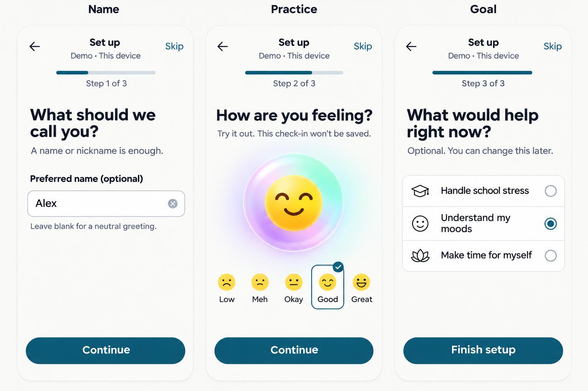
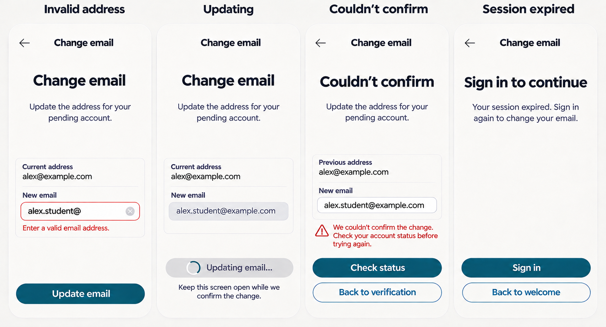
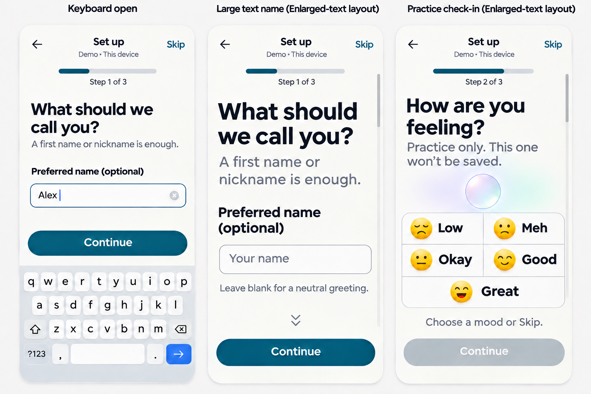
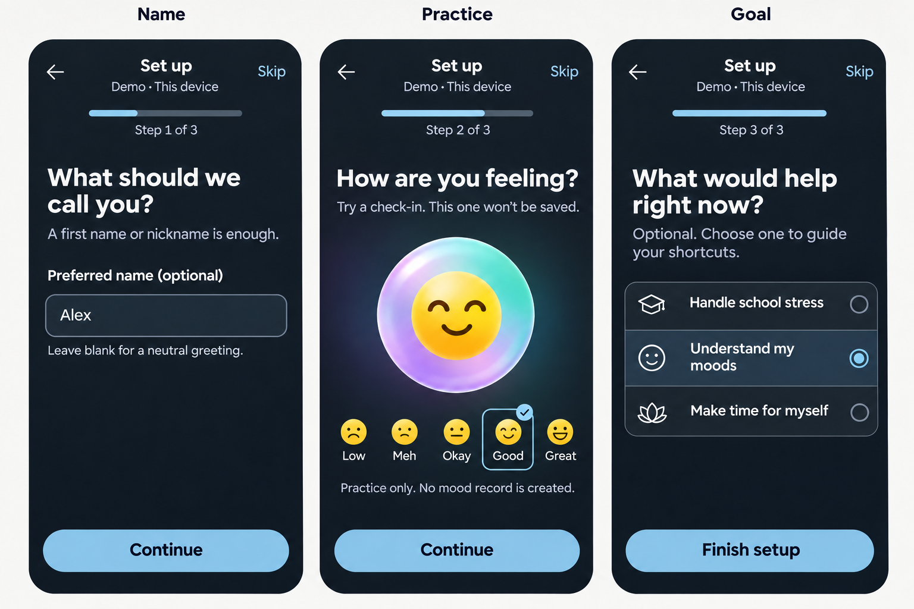

# OkayKaba — native first-run refinement

**Four boards · thirteen panels · Mockups for review**

[Open gallery](review.html) · [Design and navigation](design-and-navigation.md) · [Navigation changes for review](navigation-review.md) · [Quality notes](quality-notes.md) · [ImageGen prompts](imagegen-prompts.md)

This is a proposed refinement of the current first-run screens using the Appllama skill. Earlier mockups remain intact. No app source has changed.

## 1. Core setup · light

Compact navigator title, common progress track, quieter warm-white surfaces, a grouped goal list and a clear selected mood.

## 2. Email update and recovery

Focused account forms without decorative mood artwork. Invalid input, committing, uncertain response and expired session each have distinct recovery.

## 3. Keyboard and enlarged text

Readable labels and wrapping mood choices, a neutral-greeting path, and an action above the schematic keyboard.

## 4. Core setup · dark

The same core setup controls and choices in a dark palette with a lighter denim accent and unchanged yellow mood content.

## Review checkpoint

Review the quieter surfaces, compact header, grouped controls and dark setup palette. The email committing state proposes a brief guarded update and an escapable uncertain-outcome recovery; it is a navigation change for review. Simulator, device, full-motion and release-performance verification are deferred because implementation remains out of scope.
