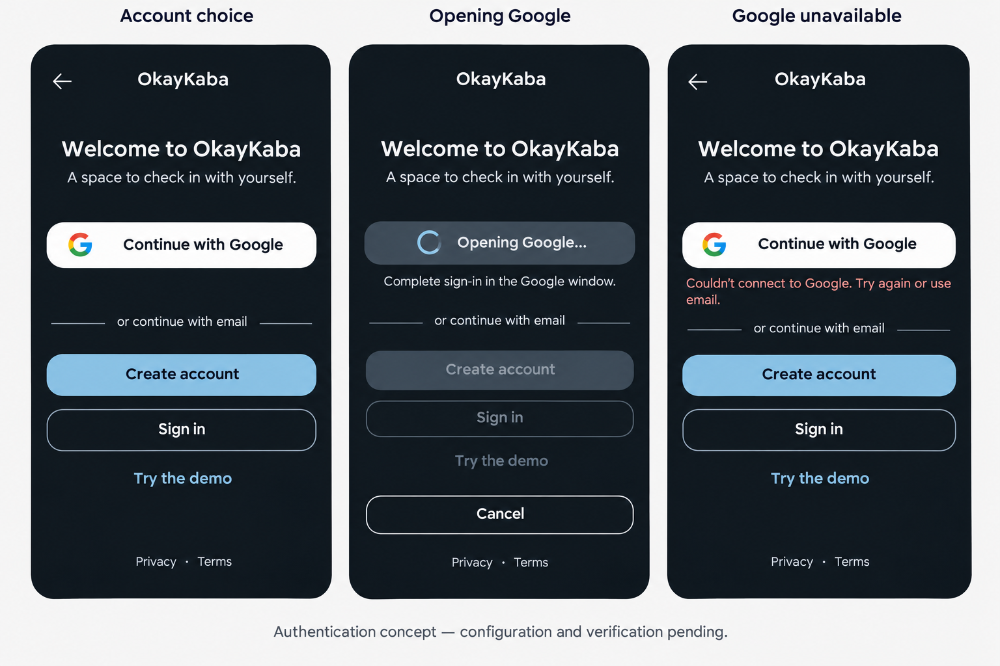

# Account-choice audit
19 November 2026 · Findings and recommendations only

## Scope and evidence
Reviewed the latest three-state account-choice mockup and its [navigation notes](../navigation-and-typography.md). Scope: hierarchy, button order, Back, Google cancellation/failure, readable contrast and separation of demo from account use. The approved dark theme and default text style are fixed.

The exact source board was copied into this folder, hash-matched, reopened and inspected during this audit. This is an audit of supplied static mockups and route intent, not a running authentication flow.

## Verdict
Keep the overall layout and order. Google is easy to find, email has its own section, returning users have a distinct Sign in action, and demo stays visible. No broad visual redesign is recommended.

Two medium-priority clarifications remain before the account branch is fully specified: explicit email-action labels and provider Back/cancellation/delay recovery. A small demo helper would improve discoverability.

## Numbered state review
| # | State | General health | Main finding |
| --- | --- | --- | --- |
| 1 | Account choice | Mostly clear | Order and grouping work; button labels rely on the email separator for context. |
| 2 | Opening Google | Needs navigation detail | Cancel is visible and competing actions are unavailable. Android Back and delayed/abandoned callback recovery need an explicit rule/state. |
| 3 | Google failure | Mostly clear | Error text and alternative paths are present. Retry/cancelled/stalled outcomes must stay distinct. |

### 1. Account choice
**Strengths:** Continue with Google is first and prominent. The email divider groups Create account and Sign in. Try the demo is lower emphasis but visible. Privacy and Terms are separate links. No extra social providers, mascot or palette change has appeared.

**Medium — Make the email intent explicit.** Rename Create account to **Sign up with email**, and Sign in to **Sign in with email**. The current divider supplies that meaning, but the actions are less clear when scanned independently or announced as controls. This is a label change, not a new route.

**Low — Explain the demo entry briefly.** Keep Try the demo after the account actions. Add a short **No account needed** helper if it fits without crowding. Continue to show the existing storage explanation before demo setup; do not put all privacy detail onto this choice screen.

**Hierarchy recommendation:** Preserve Google → email sign-up → email sign-in → demo. Keep the first two email actions clearly grouped. Do not hide Sign in behind another screen or give every option the same filled-button treatment. Google can remain provider-branded and email sign-up can retain the app accent.

**Privacy:** The board does not claim all account data stays on-device. The outside caption correctly marks authentication as a concept. The navigation notes require an explicit demo explanation and prohibit automatic personal-record import after sign-in. Actual storage behavior remains unverified.

### 2. Opening Google
**Strengths:** Opening Google… shows immediate pending feedback. Competing email/demo controls appear disabled. Cancel is an available exit. There is no false successful-sign-in claim.

**Medium — Define Back and provider-return behavior.** The app's top Back is absent, but the platform Back button still exists. Specify:
- While the provider surface is foregrounded, Android Back follows the provider/system dismissal path.
- After dismissal or return to the app, the app restores idle choices unless a valid accepted session has already committed the transition.
- On the app's pending screen, Android Back has the same outcome as Cancel; it must not leave a stuck opening state.
- Once successful sign-in has moved on, Back cannot reopen stale login/onboarding screens.

These are recommendations, not observed runtime behavior.

**Medium — Cover cancellation and a stalled handoff.** The notes distinguish provider cancellation from failure, but the board only draws opening and error. Add a neutral cancellation result or explicitly define restoration to idle with a brief status announcement. For an abandoned/slow provider flow, offer a clear return/cancel path; a retry must not start a second concurrent handoff.

The notes already prohibit late callbacks from overriding a later demo choice. Preserve that rule and verify it later; the mockup cannot prove it.

**Accessibility:** Announce opening once. Keep Cancel discoverable to TalkBack and keyboard navigation. After cancelling, restore focus to Continue with Google or the account-choice heading predictably. Disabled controls should be semantically unavailable, not just grey text.

### 3. Google failure
**Strengths:** The written error explains the failed connection and suggests email. Google remains available for retry; email and demo alternatives are restored. Back is visible again. There is no reliance on red alone.

**Recovery recommendation:** Keep the provider button's action label consistent. Distinguish user dismissal (neutral idle restoration), network/provider failure (inline error), and missing runtime configuration (hide/disable the provider according to the product's real availability, not a fake working action). The current image is explicitly a proposed configured-state design.

Preserve the current screen after failure and avoid clearing the person's chosen path or returning them to breathing. Back on idle/error should return to the previous Welcome, as the notes state.

**Accessibility:** Associate the error with the provider action and announce it once. Do not force focus back into the external provider on every retry. Verify the coral error text against the actual background before finalizing.

## Contrast: specified tokens versus rendered UI
Calculated from the written design tokens, using relative luminance:
| Pair | Approximate ratio |
| --- | --- |
| #F2F5F8 on #111820 | 16.33:1 |
| #B5BFCA on #111820 | 9.59:1 |
| #111820 on #90BEDF | 9.03:1 |

These token pairs exceed the usual 4.5:1 normal-text threshold in [W3C contrast guidance](https://www.w3.org/WAI/WCAG22/Understanding/contrast-minimum.html). This calculation does not measure every pixel of the image-generated mockup, actual provider button assets, coral error text, disabled states, link hit areas or future focus rings. It is not a compliance finding.

No contrast failure is confirmed from the screenshot. Check active text/controls, readable focus, target dimensions, text enlargement and screen-reader semantics in the eventual prototype. Inactive controls have a contrast exception in the cited criterion; their dark appearance alone is not reported as a failure.

## Recommended next design changes
1. Keep the layout, order, dark palette and default type.
2. Clarify email labels.
3. Specify Android Back = Cancel in the pending app state, provider dismissal, valid-session completion and late callbacks.
4. Add cancellation/stalled-handoff recovery coverage and an optional No account needed helper.
5. Review only this account branch again before reviewing the rest of first-run navigation.

## Limits and delivery
The audit did not launch Expo, open an actual Google credentials screen, exercise cancellation, verify configuration, create accounts, measure actual targets/fonts, test TalkBack/keyboard use or save cloud data. All interaction conclusions are about proposed behavior in notes, not verified app behavior.

No app code, mockup images or approved design tokens were changed. Only this audit report and its evidence copy were added. The audit does not approve the flow on the user's behalf or move work beyond first-run.
