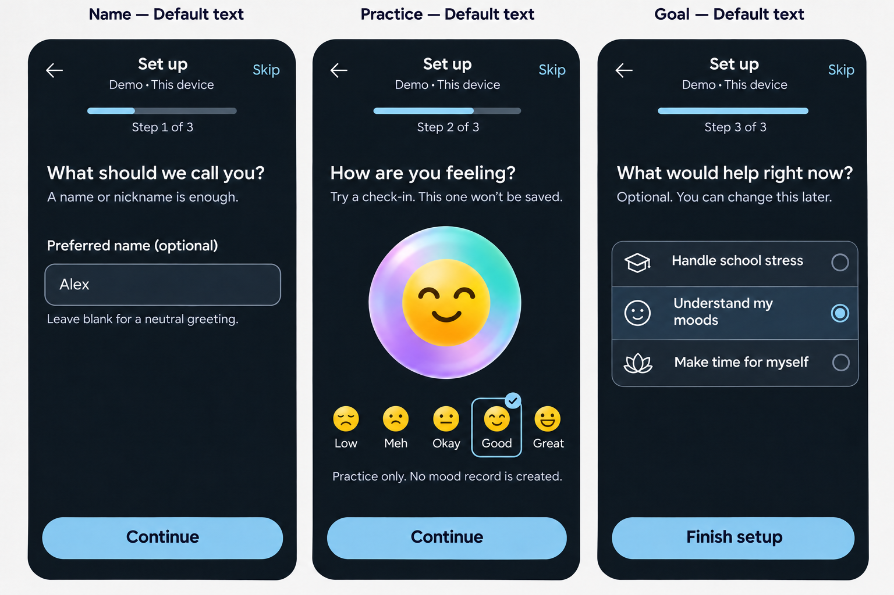
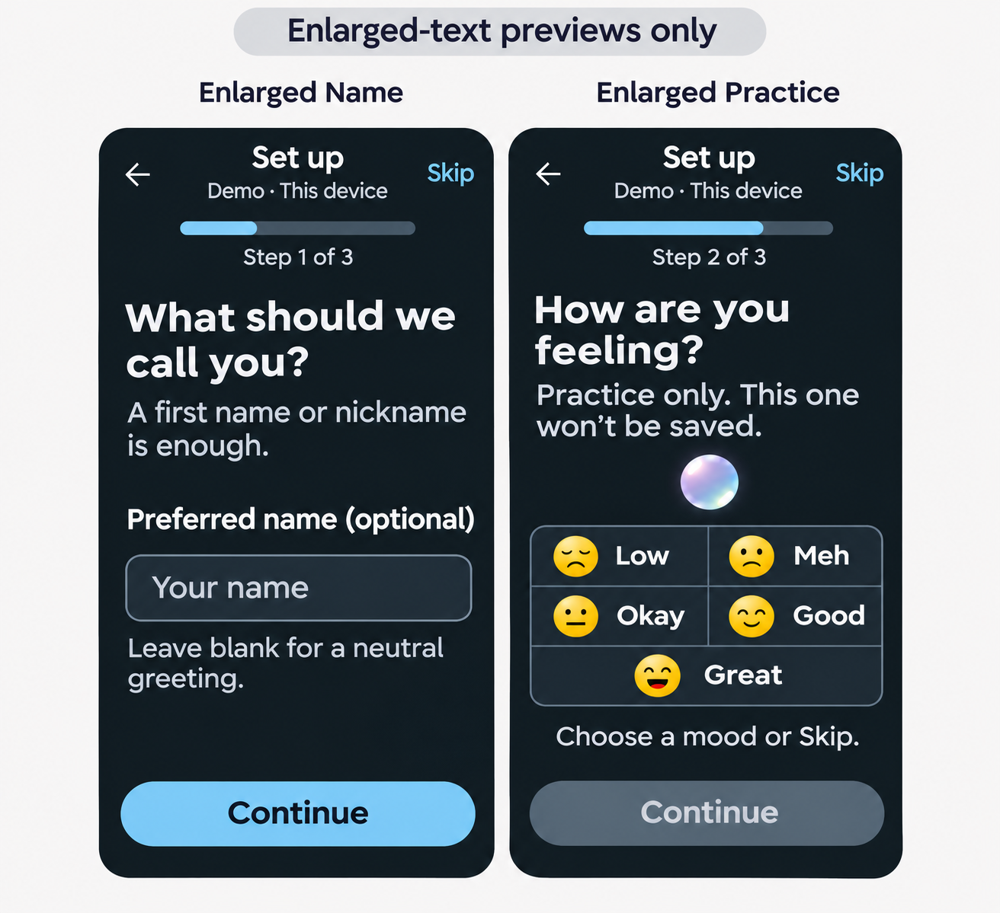
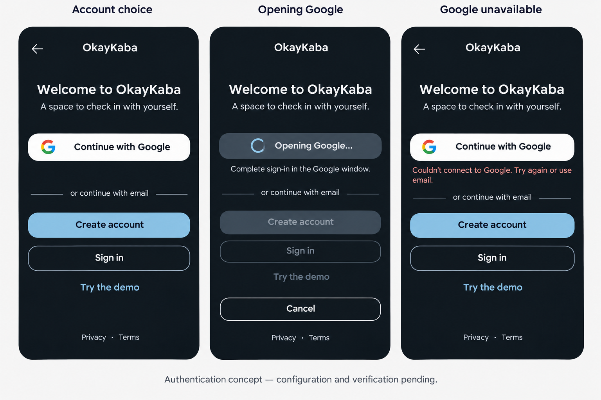

# Audit — dark typography and account choice
19 November 2026 · Static mockups and navigation specification

## Scope and user goal
Reviewed three selected saved boards, eight panels, and [navigation/typography notes](navigation-and-typography.md). Goal: keep the approved dark identity, make default headings more restrained, preserve enlarged-text access, and offer Google/email/demo paths without implying configured authentication.

Each selected image was opened and inspected locally during this audit; final copies are the evidence below. Preliminary mixed normal/enlarged output was rejected and replaced by an enlarged-only board.

## Verdict
Ready for design review. Default headings have visibly lower emphasis and mostly fit on a single line. Enlarged-text previews are separate. Google is the only proposed social provider, and email sign-up, sign-in and demo remain distinct.

This is not an authentication, accessibility, font-measurement or runtime sign-off. Generated geometry and typography approximate the logical specifications.

## 1–3. Default text — setup

| # | Screen | Health | Finding |
| --- | --- | --- | --- |
| 1 | Preferred name | Improved | Question heading is smaller/lighter than the earlier dark draft. Body and label remain readable; optional blank continuation is explained. |
| 2 | Practice mood | Improved | Restrained question title, selected mood marked by border/check, and unsaved-practice copy remain. Mood faces stay content rather than navigation icons. |
| 3 | Optional goal | Improved | Header and progress align with the other steps; grouped choices and Finish setup have clear roles. Optionality stays explicit. |

**Navigation:** Back and step-specific Skip retain their existing outcomes. No selected practice mood enters real history. Finish setup is not a claim that saving has already succeeded.

**Accessibility risks:** Physical target sizes, selected-state announcements and actual text metrics need measurement later. Small supporting copy and border contrast need checks on the real composed dark surface. The 24–28 logical-pixel headline range is a design specification, not a measured raster guarantee.

## 4–5. Enlarged-text previews — separate board

| # | Screen | Health | Finding |
| --- | --- | --- | --- |
| 4 | Enlarged name | Clear reflow intent | Headline, label and helper wrap; optional omission remains valid and Continue stays reachable. |
| 5 | Enlarged practice | Clear reflow intent | Five labeled yellow faces wrap into a grouped layout; Skip remains available and disabled Continue has an explanation. |

**Strength:** These are labeled enlarged previews and are not mixed into the default-text board. No marquee text is specified. Body/control text is enlarged along with the question heading.

**Limits:** Scrollability, safe areas, actual system scaling and screen-reader reading order are not exercised. Demonstration sizes must not become caps on the user's OS text setting. Final components must reflow further for larger settings and translations.

Mood illustrations remain generated references rather than one exported canonical asset set. Use the same approved assets across orb, normal choices and enlarged choices during detailed implementation.

## 6–8. Account choice and Google handoff

| # | State | Health | Finding |
| --- | --- | --- | --- |
| 6 | Account choice | Clear | Continue with Google, Create account, Sign in and Try the demo are distinct. No Apple/Facebook/X buttons or green app palette were introduced. |
| 7 | Opening Google | Clear pending intent | Competing email/demo actions appear unavailable; Cancel is an explicit exit. No successful-sign-in claim appears. |
| 8 | Google unavailable | Recoverable design | Inline error accompanies the provider action; email and demo alternatives are restored. |

**Navigation:** Cancel/provider dismissal returns to idle. Actual provider success routes only from a valid session and actual profile state. Notes forbid a late callback from overriding a subsequent demo choice or importing entries.

**Provider branding:** The button uses the recognizable multicolor G and complete action label. [Google's guidance](https://developers.google.com/identity/branding-guidelines) provides approved assets and supports “Continue with Google.” The generated preview is not a substitute for its approved asset/SDK treatment; brand font, logo dimensions and padding must be verified later.

**UX risks:** The handoff state needs to distinguish user cancellation from a genuine provider/network failure. The notes do so; a future prototype must prove restoration, focus return and single-request behavior. Long-running or abandoned provider windows must not trap the user.

**Accessibility risks:** Give the provider action, Cancel, error and document links meaningful accessible names. Announce opening/error once. Restore focus predictably after provider dismissal. Check disabled-control contrast, tap areas and external-window return on Android.

## Coverage and remaining work
Visible requirements covered:
- Approved dark palette and mood direction retained.
- Default heading emphasis reduced.
- Normal and enlarged previews separated.
- Google plus email account actions and demo provided.
- Opening/cancel/error intent documented.
- No other social providers, green palette or marquee introduced.
- Authentication explicitly remains a concept pending setup and verification.

Deferred checks:
- Exact logical font metrics, real system text scaling, input/keyboard avoidance, safe areas, TalkBack, contrast and target sizes.
- Google configuration, external launch, provider cancellation, errors, callback validation, session persistence, identity verification, sign-out and routing.
- Final reviewed Terms/Privacy documents and approved Google assets.
- Motion/reduced-motion and opaque-surface behavior in the eventual app.

## Recommendation and limits
Review this focused revision before any app code changes. No new blocking contradiction was identified in the intended route, but the unverified items above are not passed tests.

The audit used static PNG mockups and notes. It did not run Expo, open a real Google login, create accounts, contact a backend or test persistence. No production readiness or accessibility-compliance claim is made. No application source or other product screens were changed.
