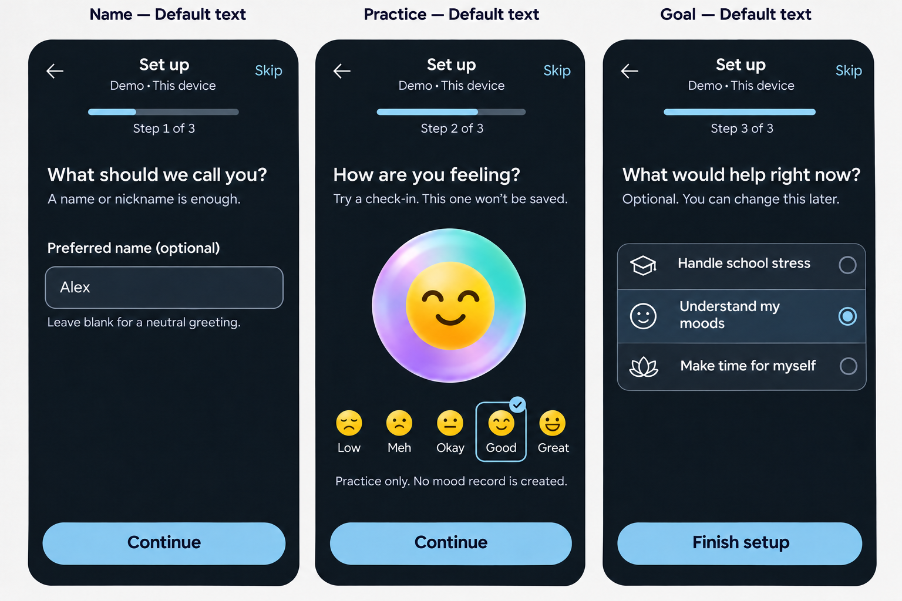
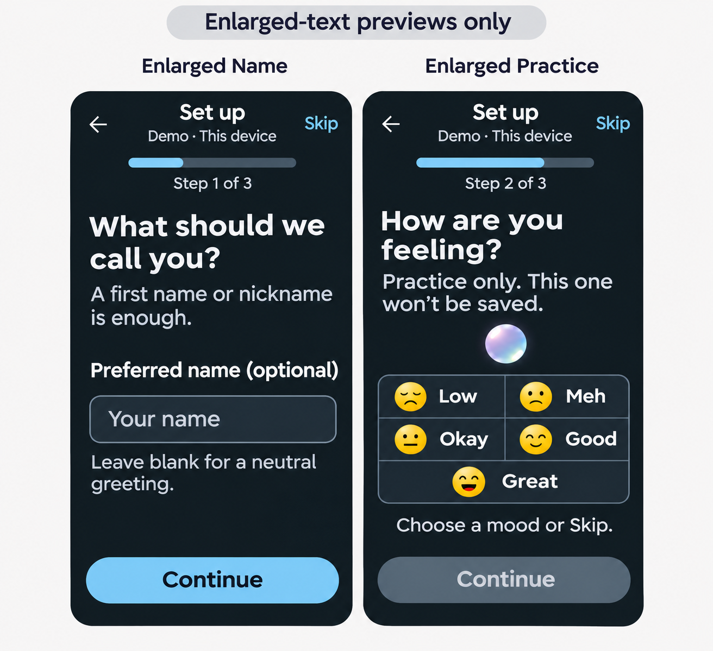
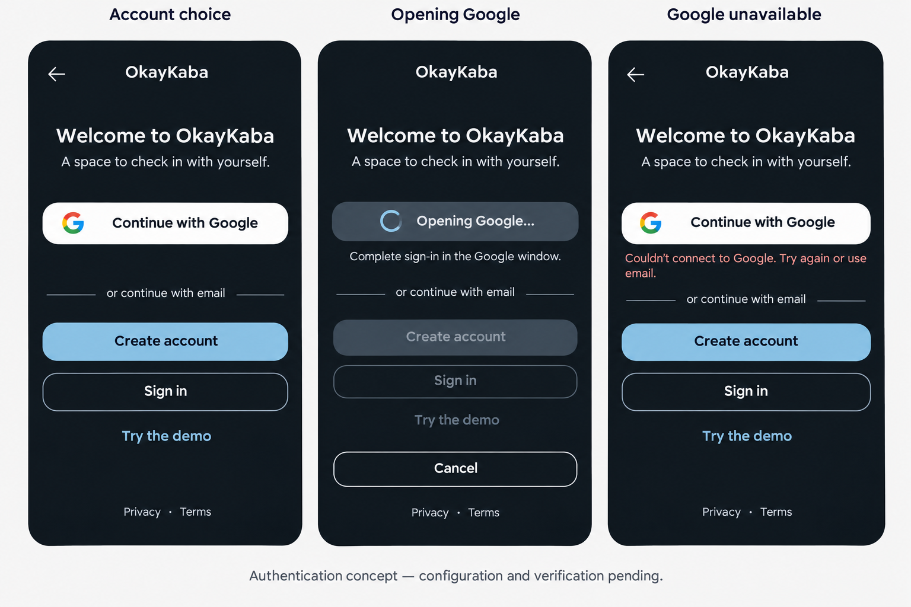

# OkayKaba — dark typography and account-choice review

**One coherent revision · Three boards · Eight panels · Mockups only**

[Open review gallery](review.html) · [Navigation and typography](navigation-and-typography.md) · [Audit](audit.md) · [Generation prompts](imagegen-prompts.md)

Default headings are intentionally more restrained. Enlarged-text previews are on a separate board. Google is the only proposed social provider; email account creation/sign-in and demo remain available. No app code or authentication configuration changed.

## 1. Default text · restrained setup headings

The normal Name, Practice and Goal screens use smaller, lighter question headings while retaining readable labels and the approved dark identity.

## 2. Enlarged text · accessibility previews only

Separate enlarged Name and Practice previews preserve wrapping, larger controls and the five labeled mood faces. They are not the default layout.

## 3. Account choice · Google, email and demo

One dark account-choice screen with idle, opening and failure states. Authentication is a proposal pending configuration and verification.

## Review boundary

Please review the default headline size and account-choice hierarchy. Exact font metrics, system text scaling, Google branding assets, authentication and runtime accessibility still need later verification. No marquee is proposed. Remaining app screens and implementation await review.
