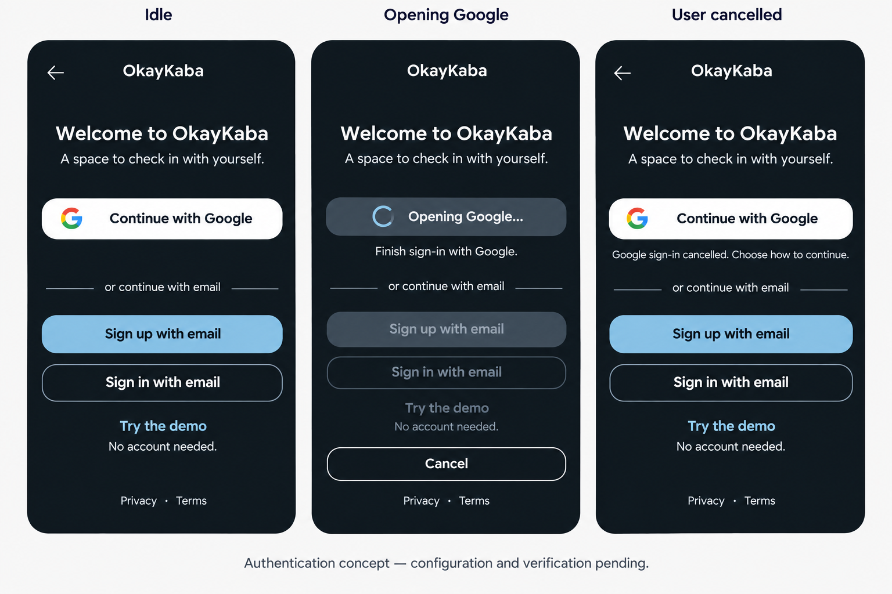
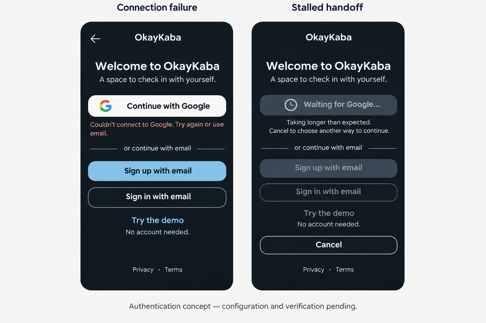

# Account-choice mockup audit
19 November 2026 · Static design review only

## Verdict
The requested five states are visible and ready for design review. The revised labels and helper preserve the action hierarchy. No blocking visual omission was found within this narrow scope. Runtime navigation, accessibility and authentication have not been verified.

Evidence: the two final PNG boards below were generated, saved and inspected during this revision. These are mockups, not captures of working app behavior. Navigation notes are a proposed contract and are assessed for completeness only.

## Steps 1–3

| # | Step | Health | Visible finding |
| --- | --- | --- | --- |
| 1 | Idle account choice | Ready for review | Google is first, followed by the filled email sign-up, outlined email sign-in and text demo action. No account needed sits directly below demo. |
| 2 | Opening Google | Ready visually; behavior untested | Pending wording and a spinner distinguish it from idle. Email/demo are muted; Cancel remains prominent. No competing app Back arrow is shown. |
| 3 | User cancellation | Ready visually; behavior untested | Neutral written feedback restores all four choices. Cancellation is not presented as a red error or a separate blocking page. |

## Steps 4–5

| # | Step | Health | Visible finding |
| --- | --- | --- | --- |
| 4 | Connection failure | Ready visually; contrast needs testing | The inline message explains the problem and offers retry/email. All choices including demo remain visible. Written error text avoids a color-only signal. |
| 5 | Stalled handoff | Ready visually; behavior untested | A static clock, Waiting for Google and longer-than-expected copy distinguish this from initial loading. Cancel is the clear recovery; no automatic retry or invented percentage is shown. |

## Design and UX findings
- Steps 1, 3 and 4: updated email-specific labels clarify provider choice. Google remains visually first. The restored layouts retain the same button order.
- Steps 2 and 5: a single Cancel path avoids concurrent sign-in and demo intents. Notes explicitly make Android Back equivalent to Cancel and require restoration before choosing another method.
- Step 3: cancellation copy is appropriately neutral and does not imply an account was deleted or that a server operation was reversed.
- Step 4: the recovery sentence wraps to two lines. Preserve flexible message height and allow vertical scrolling at larger text sizes; do not shrink text to retain this raster composition.
- All steps: dark surfaces, bright labels and restrained denim accents remain coherent with the approved account-board direction. Generated raster texture and type are conceptual, not exact token or font measurements.
- All steps: only No account needed is shown here. Device-storage details remain assigned to the existing following demo screen; that screen is outside this revision.
- The boards visibly label authentication as a concept pending configuration and verification. This footer is review-board annotation, not required in-app copy.

## Accessibility review
Visible: error meaning is written; pending and stalled states have text in addition to icons; Cancel remains distinguishable from muted choices; the outlined email sign-in is visually separate from the background.

Unverified: exact rendered contrast of coral error text and secondary labels, touch target dimensions, TalkBack order and announcements, semantic disabled states, font scaling, focus restoration, reduced-motion settings, safe areas, and opaque-material fallback. Muted pending labels must not be reused for enabled actions. Use real provider assets rather than this generated G when implementing.

## Navigation-note review
The notes specify normal Back to the preceding Welcome, provider Back/Cancel to restored choice, fresh explicit retries, and demo routing through the existing storage explanation. They distinguish foregrounding from cancellation and prohibit late callbacks from changing a later demo choice or importing personal records.

These requirements are complete enough to guide a future prototype. Static boards cannot demonstrate that they execute correctly. The notes do not establish that Google, session persistence, email authentication or cloud saving works.

## Required future prototype checks
1. Cancel or Android Back during opening/stalled; all choices restored and focus announced once.
2. Cancel → demo → delayed provider success/failure; demo remains active and no data is uploaded.
3. Cancel → fresh retry → old callback; only the current attempt may advance.
4. Actual provider dismissal, offline connection failure and unresolved handoff; no repeated launch or parallel requests.
5. SDK-persisted late sessions reconciled without activating account mode; verify against the actual configured provider.
6. TalkBack, enlarged text, contrast, targets, safe areas and reduced-motion/opaque alternatives.

## Recommendation
Review and approve the five-state presentation and navigation contract before implementation. No further first-run screens or app features were changed.
