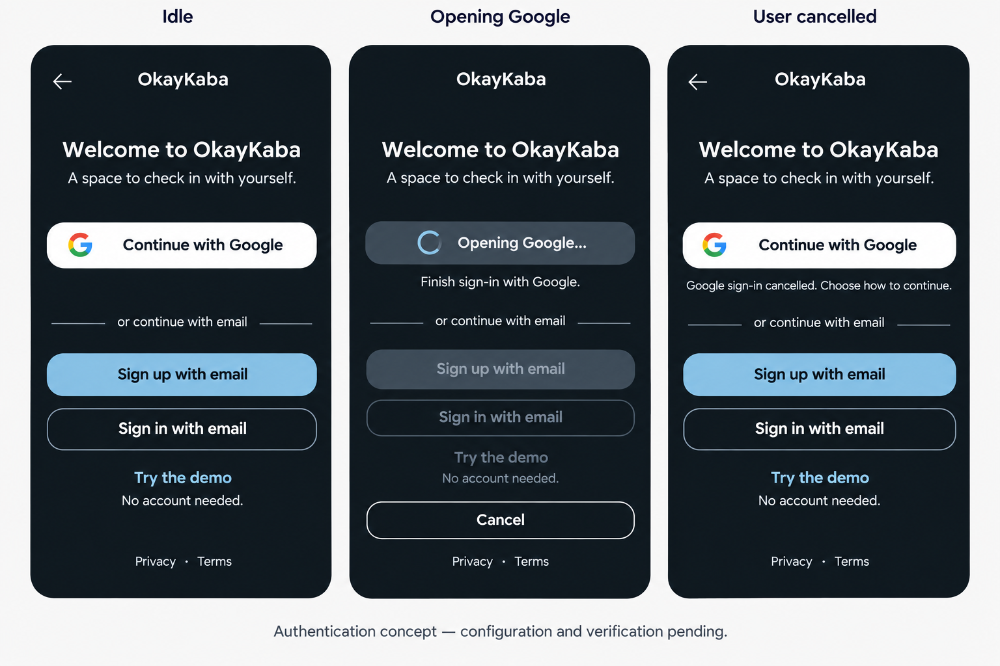
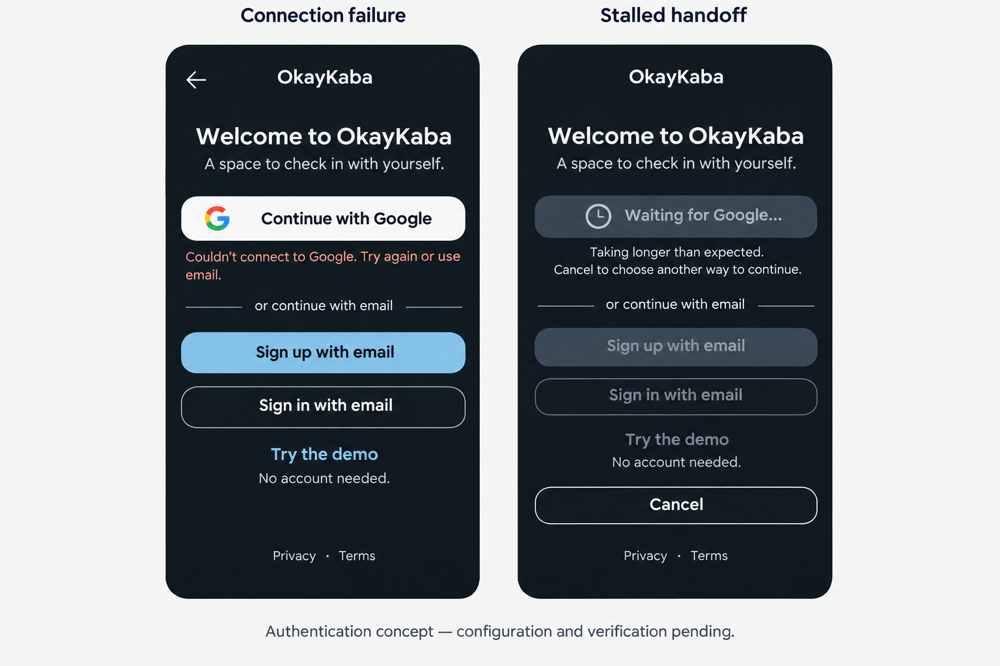

# OkayKaba — dark account-choice revision
Mockups only · Authentication proposed, configuration and verification pending

[Open visual gallery](review.html) · [Navigation contract](navigation.md) · [Mockup audit](audit.md) · [Generation prompts](imagegen-prompts.md)

The approved action order is preserved: Google, email sign-up, email sign-in, demo. No account needed appears under demo. Cancel and Android Back restore choice; stale provider responses must not override a later demo choice. These behaviors are specified, not implemented or tested.

App code and GitHub are unchanged. Stop here for design review.
