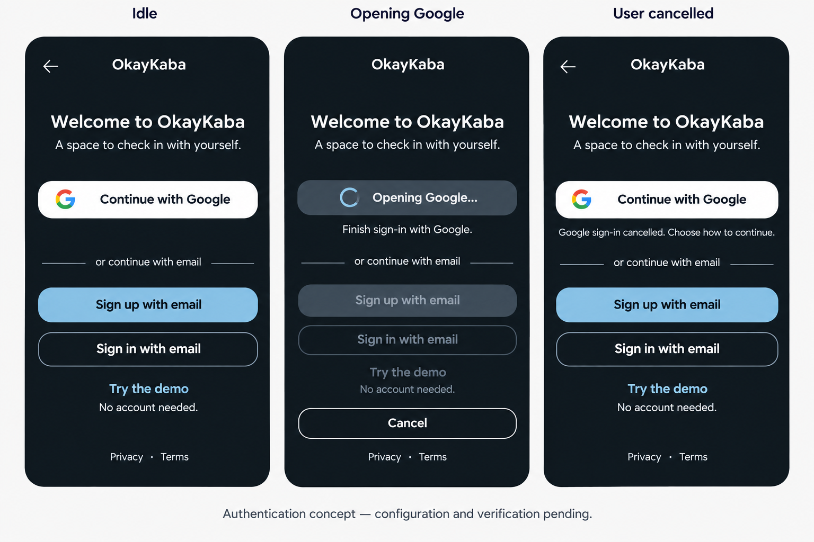
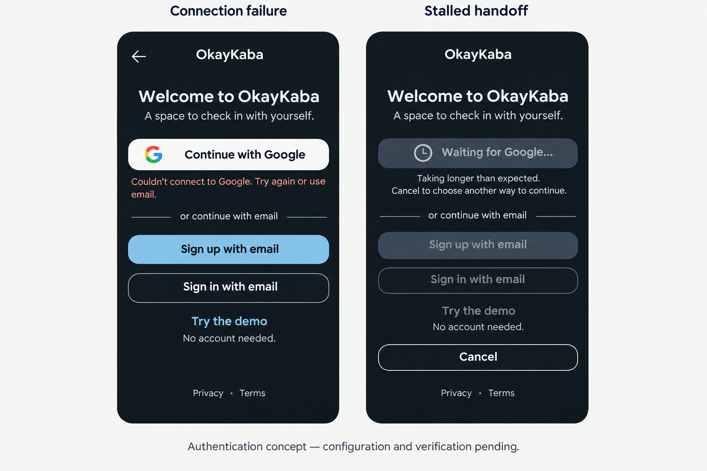
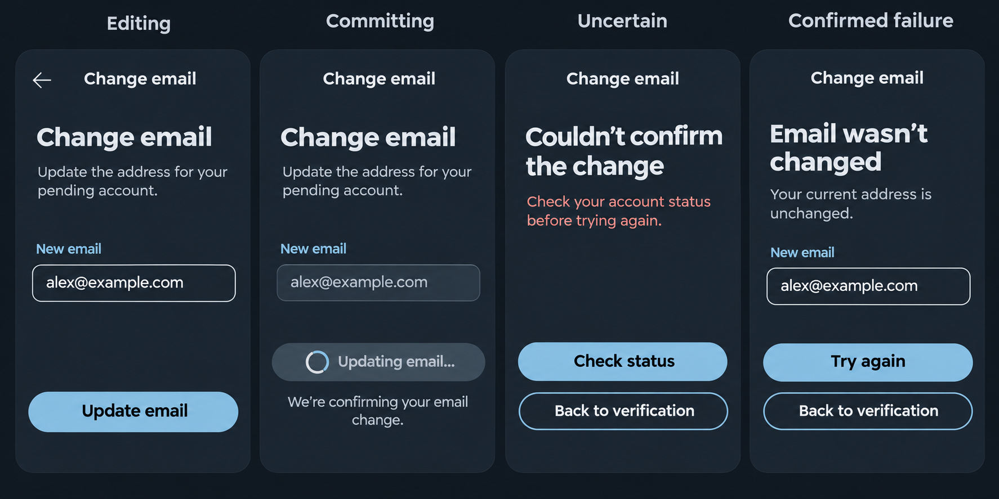
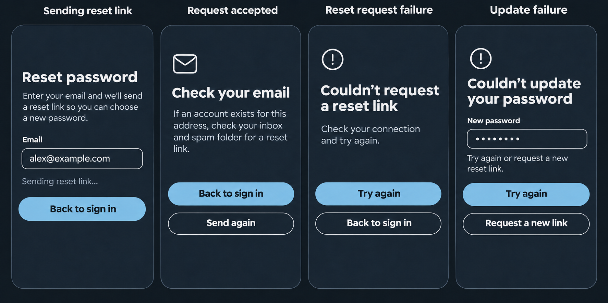
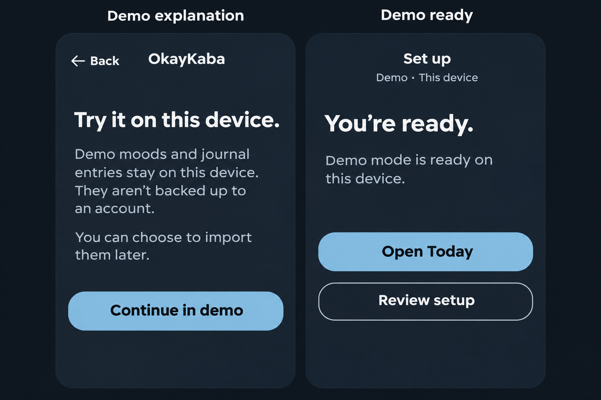
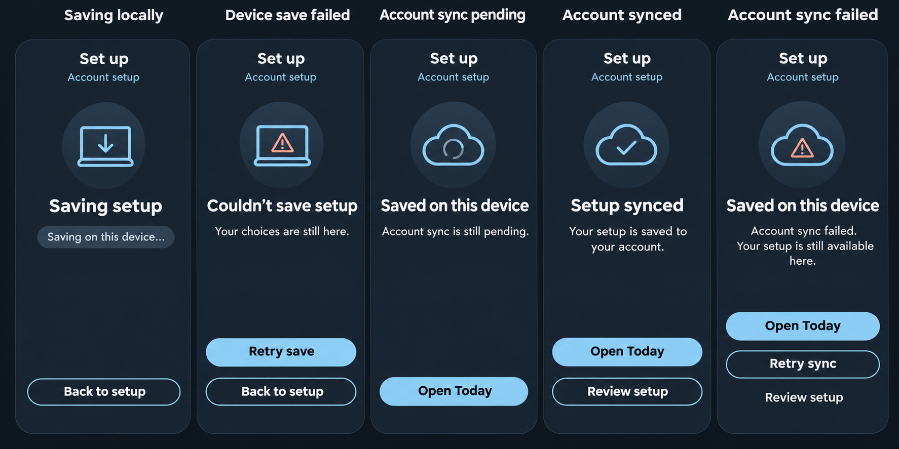

# OkayKaba first-run review · Revision 7

This is the approval walkthrough for the selected dark design. The approved account-choice board now serves as Welcome. The new boards cover demo entry, email recovery, and setup completion. Existing boards supply the breathing, Google, email entry, verification and setup steps.

## 1. Opening → Welcome

Splash hands off to optional breathing. Start begins one breath. Pause and Resume stay within it. Completing the exercise, choosing Skip to welcome or continuing from the reduced-motion screen opens the approved account choice immediately. The older Welcome with three duplicate account actions is retired. Back from idle Welcome returns to the breathing invitation without starting the exercise.

[Opening and breathing](../v2/01-opening-breath.png) · [Pause and quiet-moment frames, first two panels only](../v2/02-paused-welcome-demo.png)

## 2. Google path

Google leads the existing Welcome hierarchy and starts one handoff. Android Back or Cancel during opening or a stall restores Welcome with neutral cancellation feedback. A connection failure restores all choices, with one explicit new attempt from Continue with Google. A return without a valid session stays at Welcome with recovery. A valid returning account with completed setup opens Today directly. New or incomplete accounts enter the correct setup step.

## 3. Email entry and verification

Sign up with email opens the existing form, then verification. Sign in with email opens the sign-in form. Completed accounts open Today after a valid sign-in, and incomplete accounts resume setup. Idle forms go Back to Welcome, while verification goes Back to sign-in. Cancel or Leave during ordinary pending requests restores the originating form and invalidates navigation from that request. An uncertain sign-up emphasizes Sign in first and offers Check verification second. Verified with no app session routes to sign-in with the message “Email verified. Sign in to continue.”

[Sign-up states](../v2/03-create-account-states.png) · [Sign-in states](../v2/05-sign-in-states.png) · [Verification checks](../v2/04a-email-verification.png) · [Accepted change, expired link and verified outcomes](../v2/04b-change-email-and-links.png)

## 4. Change email

Editing and status checks allow Back. Once the app submits the actual update, briefly guard the commit against app Back, Android Back and duplicate submissions. A result or transport deadline ends the guard. When the outcome is uncertain, restore Back and offer **Check status** and **Back to verification**. The latter opens verification with unresolved status and does not assume either address is current. A status check is read-only and can be left. A still-pending or failed check preserves the uncertainty. Retry the mutation only after the service confirms the original change did not take effect, and make it an explicit tap. If the change succeeded, open verification for the new address and prevent Back from reopening the old edit. If authorization expires, ask the person to sign in again to the same account. The earlier “Leave this request” panel for an email mutation is superseded.

## 5. Password reset

Forgot password uses the email from the sign-in form. An accepted request uses generic acknowledgement and inbox/spam guidance. Back to sign in remains available while sending. An expired link leads to a new request. A valid link opens Choose a new password, then a dedicated pending state with duplicate submission disabled, then Password updated or a recoverable error. An uncertain password update should offer trying sign-in or requesting a fresh link rather than claiming the old password still works. Success returns to sign-in. [Existing expired-link, new-password and success panels](../v2/06-password-recovery.png)

## 6. Demo entry and ready

Try the demo from Welcome, sign-up or sign-in opens the device-storage explanation. Back returns to the exact screen that opened it and restores safe fields such as email. Continue in demo starts demo setup. Cancelled Google or email requests cannot activate account mode, redirect setup, sync or import data when a delayed response arrives. Check this both before and after Continue in demo. Import is a later explicit choice.

## 7. Shared setup

Name → Practice mood → Optional goal. Name may be blank, Practice can be skipped and creates no entry, and Goal can be left blank. The first Back in an open input dismisses the keyboard. Back from the first demo setup step returns to the storage explanation. Back from account setup never reopens a completed credential submission. Use the same setup layout with the mode label “Account setup” for signed-in users. Dark default and enlarged-text boards remain the reference. The demo ready mockup illustrates both Name and Goal skipped.

[Dark setup](../v5-dark-account/01-default-setup.png) · [Dark enlarged-text samples](../v5-dark-account/02-enlarged-text-only.png)

## 8. Save setup → Open Today

Local saving and failed local save both keep Open Today unavailable. Retry save writes locally. Back to setup restores choices and prevents an in-flight write from redirecting the person, even if that write completes. After a confirmed local write, account sync may be pending, successful or failed. Open Today remains available in all three cases. Retry sync only retries the signed-in account’s setup preferences. Demo ready has no cloud step. Open Today completes first-run and removes the completed flow from the Back stack.

## Design review

| Step | Review |
| --- | --- |
| Opening and Welcome | Route resolved. Approved board now has one way in from breathing. Breathing panels retain the earlier visual treatment. |
| Google | Approved button hierarchy and distinct recovery states are carried forward. Incomplete provider return is specified in the walkthrough. |
| Email entry and verification | Recovery priorities and destinations are explicit. Earlier references still depict parts of email entry and verification in light colors. |
| Change email | The guarded panel visually separates commit from uncertain and confirmed outcomes. Retry is visible only after confirmed failure. The actual status-check and reauthentication screens are covered by notes and earlier references. |
| Password reset | Dark pending and error states fill the main recovery gaps. The expired-link, password form and success frames use the existing visual references. |
| Demo | The single Back control matches the origin-aware route, and storage is explained before entering demo. |
| Setup | Existing dark examples show mode, step and optionality. Account setup uses the same layout, specified by label. |
| Completion | Local failure gives Retry save. Cloud failure gives Retry sync and preserves Open Today. Demo has its own ready frame. |

Use the approved default type scale in any prototype. Some generated headings render heavier than the approved 24–28 logical-pixel medium or semibold headings. Treat the completion icons as supplemental to the written status and use a modest mobile-friendly device icon. The Change email edit should display the current address separately from the proposed new address. Preserve the proposed address through a status check, with editing available again after confirmed failure.

Prototype checks include Android Back during the guarded commit and on the provider surface, expired authorization, repeated and delayed responses, demo storage isolation, save and sync outcomes, TalkBack focus and announcements, type scaling, contrast, keyboard clearance and touch targets. Raster boards illustrate hierarchy and copy. Runtime results remain unverified.

**Approval point:** Review the complete sequence through Open Today. Today’s check-in states belong to the next design pass.
