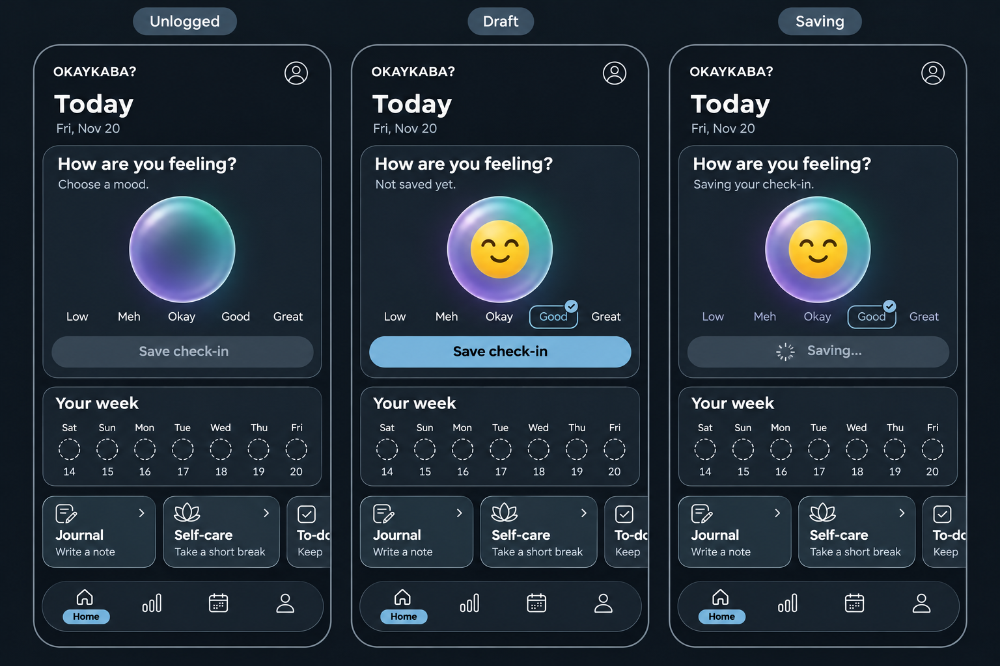
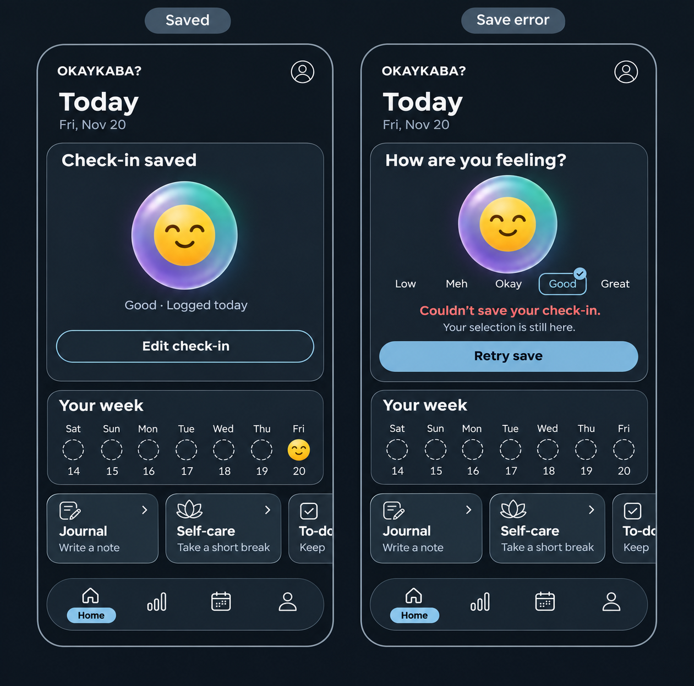

# OkayKaba · Today check-in

Design review · 20 November 2026

One inline check-in with five states. This proposal carries the approved first-run dark palette and typography into the existing Today layout. It keeps the glass orb, Your week, the horizontally scrollable activities and the four-tab dock.

| State | Mood card | Your week | Available action |
| --- | --- | --- | --- |
| Unlogged | Empty orb. No choice selected. “Choose a mood.” | Today is empty. Earlier dates are empty in this first-use example. Practice has no entry. | Choose Low, Meh, Okay, Good or Great. Save check-in is disabled until a choice is made. |
| Draft | The chosen face appears inside the orb. An outline and check mark identify the choice, with “Not saved yet” underneath. | Today is still empty. | Change the selection or tap Save check-in. |
| Saving | Hold the selected mood. Show “Saving…” and temporarily disable the mood choices and submit action. | Wait for a confirmed write before filling Today. | Save settles into Saved or Save error. |
| Saved | Show “Check-in saved” and “Good · Logged today” for the example. | The Friday 20 slot gets the same Good expression. | Edit check-in opens the inline choices with the existing mood selected. |
| Save error | Keep the selected mood in place and explain that it could not be saved. | Today stays empty on first save. After a failed edit, keep the previously saved mood visible. | Retry save, or select another mood and save that choice. |

## Interaction details

- A selection is a draft for the current day and mode. Keep it while the user visits another tab in the same session. Clear it once saved, explicitly discarded, or its day or mode changes. A failed save retains the choice. First-run practice does not populate Today.
- Editing uses the same card. Keep the last saved mood in Your week until the edit succeeds, including during a failed edit. Offer **Cancel edit** to restore the saved view. Use one saved entry per local day and mode. Freeze the target date when Save starts so a response after midnight cannot change the new day's slot.
- Retry the same logical save without duplicating a daily entry. If the app can't confirm the outcome, use “Couldn’t confirm your save” and check for the existing record before retrying. Ignore a response from another day or mode for the visible card. Demo confirms a device write. Any separate account sync status should say where the entry was saved.
- Reserve space near the action for the status or error so the week's position stays steady at the default type size. Let the card expand and scroll at larger text sizes. Use labeled options and announce selection and save outcomes once. Reduced motion swaps the face without a pulse. The dock stays clear of content and labels only the active Home tab visually, while all four tabs retain accessible names.

## Review boundary

The boards illustrate the main first-save sequence. Edit, uncertain-write reconciliation and sync messaging are interaction notes. Actual persistence, TalkBack feedback, text scaling, focus and scroll behavior need prototype verification. Review these five states before moving to Journal.
